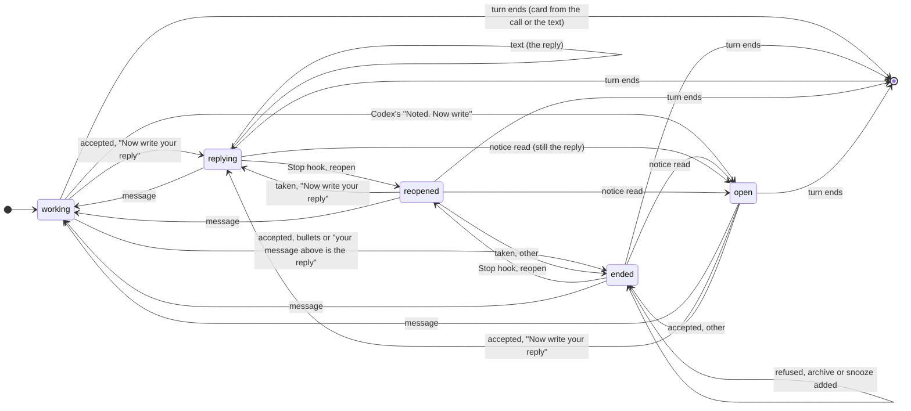

# Runner protocol: Needs you: the card a turn ends with

Part of the runner protocol. [docs/protocol.md](../protocol.md) has the rules for all of it and which file each section is in.

## Needs you

A turn the agent finished can say whether Mike has to do anything, so
"Needs you" only holds threads that are really waiting on him.

A turn that left sub-agents or a workflow going (`background` entries of
kind `agent` or `other`, finished ones included until they're read) isn't
waiting on him yet, whatever it said: what they find can change what the
agent asks (Mike, 2 Nov 2026). `needsYou` stays false, the sections keep it
under Running, and the phone's thread document leaves `needs` out until
they're done. `needs` and `asks` stay on the summary, so the card shows if
he opens the thread and he can answer early. A question or approval the
agent is stuck on (`status` "waiting") still counts straight away, and shell
jobs and monitors don't hold anything back by themselves: one is often
watching for Mike to do what he was asked. The stuck-job check (Stuck background jobs) wakes
the thread if a sub-agent stalls, so an ask can't stay hidden for good.

A shell job the thread itself waits on (a landing) holds the asks back when
the agent says so (24 Nov 2026; `JOBS_NUDGE` in needs.ts has the why): needs
"you" with a shell job running, on a CLI that wakes when jobs end (not
Codex), is refused once a turn without `askWhen` "jobsEnd" or "now". With
"jobsEnd" the `needs` record keeps `afterJobs`, the shells' ids; while all
run the summary has `asksAfterJobs: true` and the thread is as with
sub-agents above. `HELD_NUDGE` keeps the next turn from dropping the asks. No say at all with its shells running: updates.md, "Waiting on its own shells".

- **The tool.** Every thread's own agent (not its sub-agents) has
  `end_turn` in the `threadbear` tools: `{ needs?: "you" | "nothing",
  summary?: string[], asks?: { action, reply?, why?, options?,
  suggested?, links? }[], next?: string[], archive?: boolean,
  byline?: string, askWhen? }`. `byline` is under "Who started a thread".
  The asks are the agent's "What I need from you" list, written there
  instead of in its message: each is one paragraph, `action` its first
  sentence (one concrete thing to do, or a question) and `why` the rest
  (what it's about and what the agent wants back, so it makes sense to
  Mike when he has forgotten everything; the tool's schema requires it,
  the runner still takes an ask without one). `reply` is the words the
  agent wants back ("done"). `where?` (the app, site, file or person) is
  no longer in the tool's schema, as the paragraph says it, but the
  runner still takes it from sessions that kept the old tool,
  `options` up to six likely answers and `suggested` the index of the
  agent's own pick (dropped unless it points at an option). `links` (up
  to three) are where to go to do it or judge it, `{ title, url }`: a web
  page (`http(s)://`), a file or folder on Mike's Mac (`file://`, an
  absolute or `~` path), or `review:<id>`, one of the thread's design
  reviews (the id `show_options` returned, letters, digits and dashes);
  anything else is dropped. The app shows a
  picture, PDF, text file or page in the pane, opens a review's window as
  its card does, and opens anything else (a
  folder, a `.tandem` project) in its own app. A review link has no
  hover peek. The phone gets `http(s)`, `thread:` and `review:` links (a
  review one opens its Reviews sheet; the website says it opens on the Mac
  or iPhone), never a path: until 21 Nov 2026 a review link was dropped on
  the way, and a pick between three mocks reached the phone as a bare question. Mike,
  30 Oct 2026: a card's buttons opened three videos, but nothing on it
  opened the stills the agent had put up to compare. The agent calls it last, after its final
  message. The tool's description says when, so a resumed session that
  kept its old system prompt still hears it.
- **One reply.** `Settings.oneReply: true` (1 Nov 2026,
  docs/reply-card-design; on by default and out of Settings since 2 Nov,
  when Mike found it struck the right balance). Mike found the card
  repeating the message above it (thread 6fb15afc), and in other turns
  carrying all the context because the bullets had replaced a message
  that came only as narration (77e7a0a6, and an explanation he asked for
  that never showed). The agent was told to write the context three
  times, each standing alone, and couldn't know which one he'd see; in
  1,507 real turns 70% of whys repeated a message that showed, and in
  38% of turns with bullets the agent's own words never arrived. With
  one reply, `end_turn` comes first and the reply after it: `{ headline?,
  needs?, asks?: { question, options?: { label, does? }[], suggested?,
  links? }[], next?, archive? }`, then the agent's message, which is the
  turn's reply. A message with no tool call after it is never narration,
  and models write their answer there anyway; in 32 eval sessions none
  lost its reply and 2 wrote it twice (inside `end_turn` instead: 9),
  with a quarter fewer output tokens than bullets
  (`~/dev/me/misc/end-turn-eval/v3`). Nothing is refused for want of a
  reply, as it comes next: the accepted result says "Now write your
  reply" (`ONE_REPLY_NEXT`), and the runner, seeing it, keeps the turn's
  text after it, streams it, and writes it with `final: true`; thinking
  before it is kept too and folds into the work. Claude's result asks
  for a final answer that includes any draft or descriptions of choices
  needed for a decision. When words precede the call (`turnReply`), it
  asks for a self-contained answer with the result and supporting evidence
  and any requested draft, explanation or descriptions of choices in full
  (`WROTE_FIRST`). The Stop hook keeps this content reminder too. It does not ask the
  agent to reproduce its working or thinking: on 6 Nov 2026 the earlier
  "write it again in full" instruction immediately preceded an Anthropic
  `reasoning_extraction` refusal (thread ba756ff4). On 5 Nov 2026 Opus
  twice wrote a Slack draft or three designs as narration before
  `end_turn`, then replied "Nothing has been sent yet." under a card
  asking about them (thread 1d9689e6), so drafts still need to be included.
  A compaction between an accepted
  `end_turn` and its reply loses the reply too, as the summary doesn't say
  one is owed (thread 1b770c6a, 5 Nov 2026: the agent went back to work
  and the launcher plan its card asked about was never written), so the
  adapter's `SessionStart` hook, run with source `compact`, adds a reminder
  with the card's questions when no words have followed `end_turn` yet
  (`owedReplyAfterCompact`). The app shows the final
  text as the turn's reply whatever else the turn wrote. An ask's
  `question` is its `action` (no why), and its answers' labels are
  `options`, their `does` notes `optionNotes` in the same order ("" for
  none); the card draws an ask with notes as rows, a circle, the label,
  a star and "Recommended" on the suggested one and the note under it, in a box. The
  notes go up with the thread's row too (backend API 64), so a Mac
  reading another runner's thread through the relay draws the same rows;
  an older backend gets the asks without them, and the card falls back to
  plain buttons. The
  preview is `headline`, else the reply's first line. A reply that ends
  in a "What I need from you" section (a heading, bold or bare) or a
  "Nothing needed from you" line, under an `end_turn` with no asks or
  next of its own, loses it, and the card comes from it instead
  (`splitReplySection`): Sonnet wrote one there in a quarter of its eval
  sessions. The "Nothing needed from you" line comes off only as a closing
  section the done card shows all of: the line says no more than that; a
  list straight under it, with no lead-in, has every item as a row on the
  card that is the item as written (no link's address, second sentence,
  line under it, full stop or cut for length left out); and nothing comes
  after.
  Otherwise the card is still read from it and the reply stays as written,
  as it does when the section is all the reply has: on 21 Nov 2026 a reply
  that opened with the line lost both its paragraphs, and Mike got a blank
  answer (thread 649fc651).
  Under an `end_turn` that has asks, a "What I need from you"
  section loses its place too, and the card stays `end_turn`'s, so a reply
  can't say what the card under it says (`replyWithoutRepeat`; Mike took
  thread 7ac017b7's repeats on 3 Nov 2026 for it not having used the card).
  A section listing more asks than the card is left in, as it says
  something the card doesn't, and so is any prose after its list. Claude's session doesn't name `end_turn` in
  `CLAUDE_CODE_TERMINAL_MCP_TOOLS`, and its Stop hook asks once for the
  reply when the turn took `end_turn` and wrote nothing after it, or for
  `end_turn` alone (the message already written being the reply) when it
  never called it. That second nudge is the adapter's `endTurnNudge`
  output, and the `end_turn` it brings answers "Stop here" rather than "Now
  write your reply", if the turn has words of its own since its last step
  (`oneReplyAlreadyWritten`): told to write one anyway, agents wrote a second
  message that took the first's place, in 13 of 84 turns on 1 Nov 2026, one
  trading 2,359 characters for 96. Text after it is dropped, as with
  any "Stop here". Codex calls it before its final answer as before, and
  its final answer is the reply. The setting is read when a CLI starts;
  Bullet replies doesn't apply to a one-reply session. Neither provider's
  agent is sure to be shown today's form of `end_turn`. A Codex thread's
  tool list is fixed at `thread/start`, restarts included. A Claude
  session keeps each tool's definition from when it first loaded it,
  through every resume, whatever the server lists by then; `ToolSearch`
  shows that one too, and `tools/list_changed` changes nothing, even live
  (tried on CLI 2.1.316; thread 1b770c6a was refused with a bare zod error
  on 1 Nov 2026, and could only find the shape in this file). So the
  runner goes by the form a call was written in (`endTurnForm`:
  `asks[].question` or `headline` is one reply; `asks[].action` or `why`,
  or `summary`, is bullets; neither follows the setting), and only
  threads started since get today's form. Codex's handler answers in that
  form. Claude's CLI ends the turn at an accepted `end_turn` only with
  bullets, so today's form answers, reading either form's asks: under one
  reply, a call in the older form is told "Stop here" if its message is
  already written (`oneReplyAlreadyWritten`, so the Stop hook doesn't ask
  for another and its bullets don't replace it) and to write its reply if
  not. With One reply off, a one-reply call is refused until it has
  written a message (`NO_REPLY`). Claude's server lists today's form but
  lets any arguments through its own validation, so the handler does the
  checking: what fits neither form hears today's shape and order in words
  (`endTurnMisfit`).
- **Trying a step first.** Every form's description tells the agent to try
  a step with its own tools before giving it to the user, and to hand it over
  only when it really needs them or after a real attempt, saying what it
  tried (`TRY_IT_FIRST`). A card that hands over a step (`handsOverAStep`:
  an answer like "Can you do it?" or "Done", or an ask that opens with an
  instruction rather than a question) is refused once a turn, with an error
  result that starts `Not ended: this card hands the user a step`, asking for
  a try if there hasn't been one. A choice, an ask that opens a review, one
  to delete, remove, buy or pay, and one covering a sign-in the turn needs are
  left out. Called again, it's taken as it is. Nothing reaches the app. It
  can't tell whether the turn tried, as turns are busy with other work, so it
  asks; and it can't see a hand-over written as plain prose off the card.
- **A card in plain words.** A card with answers to pick from is refused once
  a turn too, with an error result that starts `Not ended: read this card as
  the user will` (`plainCardNudge`), asking the agent to reread its question,
  labels and `does` lines as someone who hasn't seen its working or the files
  it links, and reword any name it coined. Called again, it's taken as it is.
  A card that links a show_options review (`review:`) is left alone, as
  lettered mockups are fine there. Nothing reaches the app. It's a note, not
  a line in the description: in replays of cards Mike couldn't follow, the
  line changed nothing and the note rewrote every one.
- **Done in a project still going.** A Done card (`needs: "nothing"`) in a
  thread Mike started (no `startedBy`) that's in a project not archived is
  refused once a turn, with an error result that starts `Not ended: this
  card says Done, and this thread is part of a project that isn't finished`
  (`projectStepNudge`). It quotes the project's state (first 400
  characters) and says Done means the thread can be archived, so a next
  step that's Mike's goes on the card as an ask. It also lists up to six
  asks and follow-ups from the cards earlier turns ended with
  (`turn.completed`, the last ten turns or 10,000 events) that no message
  from Mike answered since (`unansweredItems`: a card answer naming the
  ask, a message with its words, or his pick in a show_options review the
  ask links to; not the runner's, a schedule's or
  another agent's, and nothing an edit cut out; items an earlier note
  already listed before a plain Done turn are dropped unless raised
  again later, as the agent saw them and judged them settled), leaving
  it to the agent which still matter. A card that archives, snoozes or waits on threads or
  the app restarting is left alone, and so is a sub-agent's call, as it
  isn't in the thread's events (a Codex sub-agent's, which runs through the
  same handler, is capped at one note a turn in memory). Turns an edit cut
  out don't count towards the ten. A project it can't read within 2 seconds
  is left out. Since 23 Nov 2026 it's also left alone while something will
  run the thread again: a background job or sub-agent of its own still
  going, or a schedule sending to it that isn't paused or finished. Called again, it's taken as it is. Since 20 Nov
  2026: the calendar site's thread said Done twice with its project's state
  saying "Next is Peter's review of the live site" and three follow-ups
  never answered, and Mike nearly archived it. He didn't want old questions
  carried onto cards by rule, as some no longer apply.
- **Bullet replies off.** `Settings.bulletReplies: false` (runner.json
  only since 2 Nov; Mike, 30 Oct 2026: he liked the folded working but not always
  the bullets in place of the agent's message). `end_turn`'s description
  has the agent write a normal message and treats the summary as the short
  version; a session reads that when its CLI starts. For a live one, the
  handler refuses bullets with no message (`NO_REPLY`), and when the
  message reached Mike only as narration asks for it again (`NARRATION_ONLY`),
  keeping what follows at any length. Codex's handler asks for its whole
  final answer. The runner marks the summary event `givesWay: true`, and
  the app then shows any of the turn's messages as the reply, however short.
  So it's per turn: earlier turns stay as they were. Previews, notifications,
  the phone and `read_thread` still use the bullets.
- **The summary.** `end_turn` also takes `summary?: string[]`: two to
  five short markdown bullets of what the turn did and found, which Mike
  reads first (29 Oct 2026, after Codex desktop: the least context to
  load, then what's next). When an accepted `end_turn` has one, the runner
  writes it into the thread straight after the call's `tool.result`, as
  an `assistant.text` with `summary: true` (`itemId` the call's plus
  `.summary`, `text` the bullets as a markdown list). So it is the turn's
  reply everywhere: the preview, notifications, the phone, the website,
  `read_thread`. The Mac app folds the turn's other `assistant.text`
  into its working, so the turn reads as one line of work, the bullets,
  then the Needs you card. Once any turn is over (`turn.completed`), the
  app shows it as Mike's messages, one "Worked for 2m 13s" line holding
  everything else, its reply, errors, a review still waiting, pictures
  the agent made, the footer and the card (Mike, 29
  Oct: like Codex desktop; no separate changes card). The reply is the turn's messages after its
  last step and before its taken `end_turn`, when they're longer than
  the summary; else the summary; else its last `assistant.text`. A
  `narration: true` text never beats the summary, as it's only the API's
  paraphrase of what the agent wrote (30 Oct 2026: one about a list of
  names showed instead of the bullets). A step is a tool call outside the `threadbear` tools and `ToolSearch`,
  counted from its `tool.result` too (a message written while it ran
  isn't after it); a `user.message` sent into the turn counts as one, and only an
  `end_turn` after it ends the answer (30 Oct 2026: the runner's "app
  restarted" landed between an `end_turn` and the message it asked
  for). Words beat a narration paraphrase with no summary too.
  Text after `end_turn` never counts. The line of work goes above the
  reply, and holds the summary when the message won. On 29 Oct 2026 the
  bullets alone hid two answers: a turn that only explained something
  showed "Explained the choice above" over the folded explanation, and a
  Sentry triage report folded away under bullets that never said what
  was broken. A sign-off line is shorter than the bullets, so they still
  win over it. While it runs, its work shows as it always has.
  A turn started by a `user.message` with `origin: "runner"` (the app
  restarted, a hook ran, a resume, a carry-on) joins the turns before it
  back to the last message that started a turn of its own (Mike's, a
  schedule's, another agent's): one line of work holding all of them and
  the notes between (their earlier summaries and the runner's messages
  too), one reply (the last summary, plus the last `assistant.text` of
  any later turn, each picked as above), and one footer with their time and
  cost added up. A note from an edit (`thread.rewound`) stays out.
  A wake-up, a turn the CLI started itself as a background job ended, joins
  the same way, but its summary doesn't take the last one's place: it
  gets a reply of its own under the one before, as nothing tells it to cover the
  stretch. On 1 Nov 2026 a wait that timed out woke an agent after its answer,
  and "still waiting on you" replaced that answer on the phone (thread
  9bc89060). A wake-up keeps the Stop hook's `end_turn` nudge, as it can
  change what Mike needs. The phone tells a wake-up from the turn before by
  its rows' `turn` (backend API 26); rows from before that read as one turn. From
  backend API 33 the first row of a wake-up carries `wokeBy` (its
  `turn.started`'s), and the phone draws the same "6 min later · Mine the repo
  finished" divider as the Mac, timed from the rows either side. The
  `end_turn` description tells the agent that in such a turn its summary
  takes the place of the last one, so it covers everything since Mike's
  message, and its work links can quote steps from those turns (Mike,
  29 Oct: an app-restart check left two summaries with notes between
  them). Text after the call is dropped as before
  (Claude), with one exception: when the turn has no message since its
  last step, so the bullets are all Mike has, the accepted result says
  only "Stop here, with no more text: the user has your bullets", words
  the runner knows it by. It used to ask the agent to write whatever the
  bullets stood for but it hadn't written, and every agent took that as
  "write a message": all 14 such turns in the next four hours wrote a
  prose repeat of their bullets, which showed in place of them. On 30 Oct 2026
  Opus called `end_turn` with "Put together the details you'll need
  for the Qantas call", wrote the details after it, and the runner
  dropped them, twice (thread 2a0a9c2c). The runner keeps the first own
  `assistant.text` after such a result when it is longer than the
  bullets (unstreamed, so a shorter sign-off it drops never flashes up),
  and the app takes text after `end_turn` as the reply, by the rule
  above, in a turn with no other words. No wording in the bullets tells
  reliably whether they point at more, so the message is kept when it
  comes, not asked for. Codex's final answer, which still follows its `end_turn`,
  folds away like the rest and doesn't take over the preview. Up to 8
  bullets of up to 400 characters are kept; a leading `-`, `*` or `•` is
  taken off. Why not just ask for bullets in the final message: in 36
  test sessions Opus 5.5 wrote a prose paragraph every time, as it
  often sends its last reply as a narration block, and in `end_turn`
  every one came back as bullets (docs/end-turn-design).
- **Links into the thread.** A summary bullet (or any message, or an
  ask's markdown) can link `work:<words>`, a step in this turn's working,
  `thread:<id>`, another thread by id or id prefix, and `review:<id>`,
  one of this thread's design reviews by id or a prefix that fits only
  one (its window opens). Spaces are fine
  inside the parentheses. The app opens the turn's work group, scrolls to
  the step and lights it up: the last step whose command (or one of its
  `&&` parts) starts with the words, else the last whose command,
  description, file path, pattern, input title or text mentions them,
  else the last whose output does, else the last thought that does. The
  input title is a Codex computer-use step's name ("Reconnect to Chrome
  desktop"), as its row only says "cua_repl: js"; without it, links to
  those steps beeped. Thoughts come last, and words inside a message's
  own `work:` links don't count, as Opus drafts its summary, links and
  all, in its thinking (at times a message too) just before `end_turn`:
  as the latest mention, that took the links from their steps (29 Oct
  2026). The agent can't see its tool calls' ids, so it quotes the step:
  models quoted the command, the command's description and their own
  lines while working, and every quote landed in the tests. The phone
  opens the turn's working in a sheet instead, and picks the step the same
  way from what it has, a step's one line: a command with a description
  comes as only the description, so a quote of the command finds nothing
  and the sheet opens with no step lit. A `review:` link opens the phone's
  Reviews sheet with backend API 86; older backends say it opens on the
  Mac. The website has the same one-line steps on the page: a work:
  link scrolls to its step, and is only its words if it finds none; so is
  a `review:` link, and a `thread:` link on a shared page, as whoever it's
  shared with can't open the others.
- **Needs from the asks.** `needs` may be left out: asks mean `you`,
  none mean `nothing`. Agents filling in a summary forgot it 2 times in
  9.
- **Once a turn, or once a message.** A second `end_turn` after an accepted
  one in the same turn is refused ("Already ended") and changes nothing; Opus
  once sent its card four times. A `user.message` since then opens the turn
  again, as it's owed an answer of its own (a message sent during a call that
  came back accepted counts, since the agent can't have read it), so that
  message's `end_turn` is taken and its card replaces the last. The other
  way round, an `end_turn` the agent wrote before it could have read a
  message sent into the turn is refused ("Not ended: the user sent a
  message while you were writing this call"), so the call after it covers
  the message too: a done card once sat under a reply asking "say go". The
  refused call's card is dropped, a sub-agent's call (never in the thread's
  events) isn't checked, and a message is refused for twice at most. The
  runner knows from Claude's CLI, which holds such a message until the
  response being written has run its tools and says `started` for it in a
  `command_lifecycle` frame when it hands it over; Codex doesn't say, so
  its calls aren't checked. A repeat with
  no new message that adds `archive: true`, where neither call has `needs:
  "you"`, is taken too, and adds only that; the first card stands. A
  background task finishing does the same as a message (a `system.note`
  with `wake`), from when the agent has read it: the CLI hands the
  notification over with the next batch of `tool.result`s (often the
  end_turn's own), so it counts from the agent's first text, thinking or
  call after one. From there its text is kept, and its next `end_turn` is
  taken and its card and headline replace the last; a repeat it was
  already writing when the note came is still refused. The app takes the
  reply from before the last card, and a one-reply message under a card
  that was replaced folds into the work. On 7 Nov 2026 a `tb land` the
  agent had sent to the background finished in the same CLI turn as its
  "landing now" card, and the real report's end_turn was refused (thread
  46de9389). Handed over with a one-reply `end_turn`'s "Now write your
  reply", it counts from the agent's first call after it instead: the text
  it writes next is the reply that answer asked for, so the Stop hook
  doesn't ask for `end_turn` again. Whenever an accepted `end_turn` says
  the message above is the reply, text after it is dropped, not a new
  reply. On 11 Nov 2026 an ffmpeg job's exit came with that answer, the
  Stop hook asked again, and the "Done." after the second `end_turn` took
  the full reply's place (thread dcdc60a3).
- **A reply first.** `end_turn` is refused (an error result) until the
  turn has replied to Mike: a `summary` in the call itself, or an own `assistant.text` after the turn's last
  `tool.result` from a tool outside the `threadbear` server, and after
  its last `user.message`. The thread's own tools (`pin`,
  `update_project`, a refused `end_turn`) and `ToolSearch` (which loads
  a deferred tool's schema, often `end_turn`'s own) say nothing he has
  to read, so a message, then `pin`, then `end_turn` is fine; a progress
  line, then more work, then `end_turn` is not. An agent that drafted its answer in
  thinking and went straight to `end_turn` left Mike a folded work group
  and a card, twice in one thread (28 Oct 2026). A reply Claude sent as
  a thinking block signed as narration is an `assistant.text` (see
  Transient events), so it counts; a thinking block signed as thinking
  doesn't. When the only reply was such a block (`narration: true`,
  whose text is only a summary of it), or the last was and no words
  came after the last tool call of any kind (a status line, then
  `read_thread`, then the answer as narration, 29 Oct 2026), and there
  are no summary bullets,
  the accepted result asks for the message again in full, and the
  text after it replaces the summary. The SDK runs a tool as
  soon as it reads the call, at times a few frames ahead of the runner's
  log, so the handler waits up to a second for its own call to land
  before judging; one that never lands (a sub-agent's, which the events
  never see) is acknowledged. The refusal asks for the complete answer
  and any supporting evidence in ordinary text. Keep that reminder about
  the result Mike needs, without asking the model to reproduce internal
  reasoning.
- **Codex calls it before its answer.** Codex's final answer ends its
  turn, so nothing can be called after it. Told to call `end_turn` after
  its final message, Codex never once did, and GPT-6.1-Sol wrote the call
  into its answer instead, raw tool-call tokens and all (28 Oct 2026). So
  a Codex thread's `end_turn` (`buildThreadbearTools`' `provider:
  "codex"`) asks for it as the last tool call, just before the final
  answer. It is never refused for want of a reply, as the reply comes
  next, and its result doesn't start like an accepted one, so the runner
  keeps the answer written after it. Codex threads started before then
  keep the old description, which was fixed at `thread/start`; for them,
  the Codex normalizer cuts a tool call written into a message (from its
  first ` to=functions.` token to the end) off the text.
- **Ending on the tool.** Claude Code nudges a model whose reply after a
  tool result has no text ("[Your previous response had no visible
  output. Please continue and produce a user-visible response.]"), and
  `end_turn` is that tool result in every turn, so every Claude turn
  ended with the nudge and a throwaway "I've marked this thread as done"
  under the real answer. The runner names `end_turn` in the CLI's
  `CLAUDE_CODE_TERMINAL_MCP_TOOLS`: a successful result from a tool named
  there lets the model's empty reply end the turn quietly (CLI 2.1.312;
  older CLIs ignore it and nudge as before). A refused `end_turn` is an
  error result, which doesn't count.
- **Next steps.** With `needs: "nothing"`, `end_turn` takes `next?: string[]` (up to three distinct strings ≤ 120 chars on `turn.completed`, dropped on `needs: "you"`), plus `nextPick?: "any" | "one"` and `nextSuggested?: number` (backend API 103). `nextPick: "one"` is emitted only when `next.length > 1` (absent means multi-pick `"any"`), and `nextSuggested` only with `nextPick: "one"` as a valid index into deduplicated `next`. Absent `nextPick` renders under "Or carry on" with multi-select ticks; `"one"` renders under "Or pick one" with radio circles and a star "Recommended" mark on `nextSuggested`. Clicking selects rather than sending. Pending `next`/`nextPick`/`nextSuggested` persist on `ThreadRecord.needs`: on a non-Mike wake (review, another thread, schedule, restart, waitFor), the runner reminds the agent once per turn and carries them forward if a Done turn omits `next` (`next: [...]` replaces, `next: []` clears, `needs: "you"` drops, and any message from Mike clears). Encourage real follow-ups and next-direction forks without filler (Mike, 30 Oct & 26 Nov 2026).
- **Archiving itself.** `end_turn` also takes `archive?: true`. With
  `needs: "nothing"`, a turn that completes archives its own thread once
  it's over, with a `system.note` saying why; the thread can't archive
  itself mid-turn, as that stops the CLI. It's ignored with `needs: "you"`,
  on an interrupted or failed turn, and when a message is already queued.
  A turn the CLI opened by itself (a background job or sub-agent ended)
  can archive too, as that's where an agent waiting on the job reports
  it's done; until 23 Nov 2026 those dropped it silently, and a thread
  that said it was archiving itself stayed in Mike's inbox. None of them
  applies while a message of Mike's that an interrupt left unread is saved
  for later (`interruptedMessages`), as that turn never shows it.
  A message sent into the turn after that call cancels it, until an `end_turn`
  asks again, so a thread doesn't go while Mike is still talking to it.
  The description tells agents to use it only when Mike asks, so a thread
  he hadn't finished with doesn't vanish from his inbox.
- **Hibernating itself.** `end_turn` also takes `snooze?: string`: when
  to wake, as `update_thread`'s `snooze` takes it (`30m`, `2h`, `1d`,
  `tomorrow`, an ISO time, `restart`), or else words (`"when the phone
  arrives"`), which go to `threads.hibernateWhen` as if Mike had typed
  them into Wake when…. It applies on the same terms as `archive`: once a
  completed turn with `needs: "nothing"` is over, with no message queued,
  and a `system.note` says until when. `archive` wins if both are given.
  A time that has passed, or words the model can't read, leave the
  thread in the inbox with a note saying why. `"off"` and words over 300
  characters are refused, so the agent can say it again. A repeat
  `end_turn` that adds `snooze` gets through as one adding `archive`
  does. On 2 Nov 2026 "let's hibernate this thread until it arrives" could
  only be met by a helper thread, as `update_thread` and `tb snooze`
  refuse to snooze the thread they run in. The description also has an
  agent hibernate when what's left waits on another thread or a job that
  will message it back (a message wakes it, see `threads.send`), with a
  time by which that should have happened. Hibernating or archiving releases
  this thread's CLI and stops its background jobs, including shell jobs waiting
  in a queue.
  A saved scheduled message does not preserve those jobs. To keep one running,
  end the turn without `archive`, `snooze` or `waitFor`; use `schedule_message`
  separately if the agent needs to check it later. Runner updates still apply
  the time limits under [Handovers](updates.md#handovers). Jobs owned by another
  thread keep running when this thread hibernates to wait for their report.
  On 5 Nov 2026 a thread
  waiting on another thread's report ended as done in Mike's inbox,
  as the description then allowed it only when he asked.
- **Schedule checks** (`runner/src/schedule-check.ts`; an experiment,
  `scheduleChecks`, from 6 to 11 Nov 2026, standard since). A schedule's `check` is a shell
  command (`/bin/sh -c`) its runner runs before each due run (not Run
  now), in the schedule's folder (a thread schedule's thread's folder),
  in its own process group, for at most 60 seconds (or the schedule's
  `checkTimeoutSecs`, a whole number from 1 to 300), with
  `THREADBEAR_SCHEDULE_ID` and `THREADBEAR_CHECK_STATE` (a file of its
  own under `<home>/schedule-checks/`) set. Exit 0 with nothing printed:
  the run is skipped (`lastRun: { outcome: "skipped", note: "Its check
  found nothing new." }`, `runs` unchanged) and its next time planned.
  Exit 0 with output: the run goes ahead with "Its check found this:"
  and the last 8,000 characters of stdout and stderr under the message.
  Anything else (a non-zero exit, a timeout): the run goes ahead with
  "Its check failed (…)" and the output, so a broken check isn't silent.
  Output (either kind) is kept in
  `<home>/schedule-checks/<id>.<hash of the command>.kept.json` (or in
  memory, if that can't be written, with one more try to write it as the
  runner stops), until a run carrying it is sent: a
  run refused by a restart or handover, a failed send or a skip because
  the last run's thread is still going leaves it, and the next due run
  sends it without running the check again (a check that keeps state
  won't print the same news twice; 6 Nov 2026, a report lost in a
  handover). Run now doesn't run the check but sends what was kept, and
  answers `busy` while the check is running (here, or in the release
  handing over). What was kept belongs to its command: a run of a changed
  `check` (or one changed while it ran) neither sends nor replaces it,
  and it's sent if that check is put back. Kept output stays on the
  runner whose check printed it, as the check's state file does. A one-off whose send failed keeps it for a new `at`; it goes
  with the schedule (deleted, or pruned a week after finishing). A
  stopping runner waits for checks under way before it exits (up to
  their time limit, or 15 s when stopped by a signal, as launch.mjs
  kills a child 20 s after its own SIGTERM), and while one runs its
  process is named in `<id>.running.json` with its time limit
  (`limitMs`; one without is a minute's), so a next release that finds
  a live one, younger than twice that limit, leaves the run due rather than running the check again. A
  runner killed mid-check can still lose what it printed. A backend run is claimed before its check, and recorded after (a
  check longer than the claim's two minutes outlives it; the marker is
  what keeps another process off it then). With
  the experiment off a `check` is kept but not run. Owned rows carry
  `check` from API 51 and `checkTimeoutSecs` from API 55; the agent
  tools take `check` and `checkTimeoutSecs` only while the experiment
  is on.
- **Card reviewer** (standard since 20 Nov 2026, an experiment before;
  `runner/src/runner/card-review.ts`). In a thread whose `permissionMode`
  is `auto`, a tool approval across any provider (`requestApproval`, except
  `ExitPlanMode`, `permissions`, and any card whose adapter sets
  `noReview: true` because what Allow does isn't shown whole — such as
  Codex's file change and `writeStdin` cards or an ACP edit without its
  change)
  or a threadbear tool's own card (`requestAgentApproval`, except
  `create_thread`, `update_thread`, `schedule_message`, `update_schedule`,
  `move_thread` and any marked `noReview`, whose access lasts past the call) first goes to a
  small-jobs `generate` with `strong` (Opus on Claude, falling back to the
  pool's next small-job provider when Claude has no room or can't run, with no tools), shown the card's
  title, the call's whole input (`wholeInput` on the request, as the card's
  `input` may have parts cut short), the thread's opening message, Mike's
  latest message and any newer one not from him, labelled as such (a brief
  over 12,000 characters means the card goes to Mike),
  under a system prompt that treats all of that as data, each piece between
  `BEGIN <tag>` and `END <tag>` lines with a random tag per call. Only an answer
  whose JSON has `"verdict": "allow"` allows: the call goes ahead with a
  `system.note` "Allowed by the reviewer: <title>. <why>" and no
  `approval.requested` is ever sent. Anything else (`ask`, unreadable, the
  call failing, a private folder, input over 40,000 characters) puts the
  card up as before, after a `system.note` with the reviewer's reason when
  it gave one. The answer must be that JSON object alone (a code fence at
  most) with a non-empty `why`. The thread stays `running` while the
  reviewer thinks, and the call sits in `rt.reviews`: Stop or the turn
  ending answers it `expired` at once, and a message from Mike `deny`
  (as for a card he wrote instead of answering; a subagent's call, which
  his message doesn't decline, gets a card rather than the verdict made
  before he wrote), and deleting the thread
  `expired`, with no card. A thread
  switched out of Auto meanwhile gets the card. Ask, Full access and plans
  are never reviewed. An `update_project` card also shows the reviewer
  what the brief changes (`review` on the agent approval request, never on
  the card): for each of title, goals, state and notes it changes, the
  line counts before and after and the changed lines with three lines
  round them, worked out from the project as it is (notes as they'd be
  saved, with `editNotes` and `appendNote`, trimmed and with CRLF as LF), and the names of
  the other fields it changes, which the reviewer judges from the input.
  A field whose changed lines pass 20,000 characters gets only how many
  lines go and come, to be judged as a rewrite. Just before the write,
  if the title, goals, state, notes or folders changed while the card was
  up (or under review), the call is refused, as a whole new notes or
  folder list would undo that change; `notes` with `appendNote` is saved
  in one update. When the reviewer left a card for
  Mike with a reason and he says no (Deny, or writing instead), the
  answer carries it as `reviewer`, which the agent is told after the
  denial, so it can tell him why he was asked.
- **Review by another lab** (`Settings.labReview`, on unless
  `runner.json` has `"labReview": false`, Settings > General > Code
  review; `runner/src/runner/lab-review.ts`. An experiment from 6 Nov
  until 10 Nov 2026). A turn that would count as finished
  (as for Waiting on threads, below) and whose `edit.diff` events change
  at least 5 lines outside `.md`/`.txt` files, in a thread that isn't
  itself a review, with fewer than 3 reviews since Mike's last message
  (`labReviews` in thread.json; any message not from the runner resets
  it), isn't marked finished. Instead the runner creates a thread in the
  same folder (no worktree of its own), with the first thread's
  `permissionMode` (never more access than it has: Full stays Full, Ask
  and Auto stay as they are) and the reviewer's model and effort (its
  provider's default model and high when it names none),
  with `startedBy: { kind: "thread", label: "Review" }`, `reviewOf` set
  to the first thread in thread.json, and a brief: the latest user
  message, the reply, the files and the diff (up to 40,000 characters),
  each in a fence one backtick longer than any run in it, so nothing in
  them can close it, and marked as data to review, not instructions. A
  reviewer billed per token (an OpenCode login: its Zen balance or a
  Gemini API key) also gets a reading budget: work from the diff, about 8
  reads or searches, no test suite, since every read is billed again on
  each later step.
  Its login is the first reviewer's in `Settings.labReviewers` whose
  provider isn't the thread's and that has a login with room
  (`pickInPool` over the pools with no folders, then a login no pool
  holds), else a fresh session of the thread's own provider. A change of
  `labPanelLines` lines of code or more (runner.json, 150 when unset), or
  code under a risky path (a path part named auth, oauth, login, password,
  secret, crypto, encrypt…, payment, billing, stripe, permission or
  security), goes to the review panel instead: every reviewer in
  `Settings.labPanel` that has a login with room, the thread's own provider
  too, each in a review thread of its own at once, with a line in the
  brief saying others are looking too. With fewer than two of them able
  to, the one reviewer above reviews. The thread waits on all of them
  (a `waitingOn` entry each, `review: true`) and wakes once every one has
  finished or gone, with all their findings numbered together, each with
  `by` naming the reviewer, and each one's reply cut to fit 12,000
  characters between them, at most 20 findings in all (the most serious;
  the message says how many were left out). One that finishes while the
  rest still work is archived then, its reply and verdict kept in its
  wait (`done.verdict`). The round passes only when every one reviewed,
  gave a verdict and found nothing; with none back, it isn't delivered.
  A panel's `independent` is true when any of it is another lab. For a folder a
  pool is kept for, only that pool's logins are used, and a kept pool's
  logins never review anything outside it. The first thread gets a
  `system.note` saying who reviews and whether it's another lab, then
  waits on the review as `waitFor` would (`waitingOn` entry with
  `review: true` in thread.json). The review's reply (up to 12,000
  characters) comes back as an `origin: "runner"` message asking it to
  fix what holds up, naming any files the review edited, and the review
  thread is archived (`archivedBy: "threadbear"`). With no login to
  review on, a note says so, once until the next message. A runner that
  is draining (Handovers), restarting or stopping makes no threads, so it records
  `labReviewOwed: { turnId, seq, reply? }` in thread.json instead (`seq`:
  where that turn's events end, which its diff is read back from), and the
  thread isn't marked finished. The runner that adopts it (after any
  resume the restart asked for, and not before it's listening) or next
  starts (once listening) starts the review then. A thread busy or
  hibernating by then (a resume, a queued message, a snooze or `waitFor`)
  keeps it for its next completed turn: one that finishes reviews its own
  change if it made one worth it, else the owed one, and one that
  doesn't (it needs Mike, or waits) drops it. An archived thread, or an
  edit that cuts the owed turn, drops it too.

  The review is a gate (Mike picked a findings ledger, 11 Nov 2026,
  thread d42a3d91): pass or fail on concrete findings, not a score, as
  labs score differently and a loop chases a number. `end_turn` takes
  `findings?: object[]` (at most 20) for it. The reviewer's brief asks
  for its verdict there, `{ severity: "high" | "medium" | "low", where,
  claim, case }` per finding that holds up, or `[]` for a pass, and its
  `end_turn` is refused without one (`reviewVerdict` on its record; an
  entry with no `claim` isn't a finding, severity defaults to medium).
  The verdict is the latest turn's: a later turn of the reviewer's that
  calls `end_turn` without one (a report on tests it left running)
  leaves none, and the round counts as given no verdict. It's asked for
  only while the reviewed thread still waits on that review, so a review
  thread from before, or one reopened later, isn't.
  The verdict's findings go into the reviewed thread's ledger
  (`labReview` in thread.json, cleared with `labReviews`), numbered on
  from earlier rounds' (`ReviewFinding.id`, stable), and its wake
  message lists them by number and asks for an answer to each in its
  own `end_turn`: `{ id, outcome: "fixed" | "disputed" | "left", note? }`.
  Until it gives one for every finding of the round, with a note on each
  disputed one and `needs: "you"` with an ask for any left (with no
  ask, no card would show it), its `end_turn` is
  refused (`Not ended: the review`, at most twice a turn, then taken as
  it is, as a session holding the older form of the tool can't send
  them). The turn that answers carries the ledger on its
  `turn.completed` as `review`:

  ```ts
  type ReviewFinding = { id: number, round: number, severity: "high" | "medium" | "low",
    claim: string, where?: string, case?: string, outcome?: "fixed" | "disputed" | "left", note?: string,
    by?: string /* which of a panel found it */ }
  type LabReviewLedger = { reviewer: string /* "Codex (codex-1)"; a panel's names joined with ", " */, independent: boolean,
    rounds: number, threadId: string /* the latest round's review thread (a panel's first) */, passed: boolean,
    panel?: { reviewer: string, threadId: string, independent: boolean }[] /* the latest round's, when several reviewed at once */,
    unstructured?: true /* a round gave no verdict: its reply is all there is */,
    unchecked?: true /* fixes in the last round, which no review looked at */,
    findings: ReviewFinding[] }
  ```

  A message that isn't Mike's (another thread's, a schedule's) doesn't
  clear a ledger whose findings wait for answers; his does. A finding it
  fixed gets another round on that turn's change whatever its size and
  whatever it touched (the 5-line minimum and the docs exception don't
  apply), with the earlier
  findings and answers in the brief, so the reviewer checks the fixes
  and the disputes; a round that finds nothing passes and the agent
  finishes. Disputed or left alone start no round. The ledger is drawn
  as a quiet row in the transcript, over the turn's reply (under its
  folded work), on this runner's own threads; it was on the done card
  until Mike moved it, 12 Nov 2026, as it happens in the background.
  Since backend API 76 the thread's row carries it, scrubbed and cut,
  while that turn is the last word (sync's `lastEnd`), and another Mac
  draws it the same way (the relay puts it on that turn's
  `turn.completed`). `phone:thread` returns it too, but the phone and the
  website don't draw it yet: they show the agent's reply, which says what
  was found and what it did about each. A reviewer that gives no
  verdict (after the refusals) is handled as before: its reply goes
  across and nothing is enforced.
- **Waiting on threads.** `end_turn` also takes `waitFor?: string[]`, up
  to 5 thread ids (or unique prefixes) on this runner, with `needs:
  "nothing"`. Once the turn is over it hibernates on the same terms as
  `snooze`, with `waitingOn` on its summary and a `system.note`
  ("Hibernating until "X" finishes, or <time> at the latest."). `snooze`
  is then the latest it wakes, as a time (words aren't read here); left
  out, a day. A named thread is done once it has finished a turn (its own
  or one its CLI opened after a job ended) with `needs: "nothing"`,
  nothing queued, no sub-agent or background job running and no `snooze`
  or `waitFor` of its own, with no new work since. A job that ended
  during the turn (or just before it) holds the finish for the wake grace
  (15 s from the turn's end): the CLI may open a turn to read its result,
  and that turn's end decides; with none (it mostly folds the result into
  the turn it's in), or once the CLI exits or the runner stops, the held
  card finishes the thread after all, quiet-inbox and the inbox guess
  included. Not if Mike went back to an earlier message meanwhile, and one
  he snoozed meanwhile starts no lab review. Or it has been archived
  or deleted. The runner keeps each thread's last finish and its reply on
  the thread (`finished` in thread.json) and drops it at any new work (a
  message, a review's answer, going back to an earlier message, any turn
  starting, including one its CLI opens), so no clocks are compared: waiting on an
  idle thread that has finished wakes at once with that reply, and one set
  going in the waiting turn counts only when it finishes that. The waits
  are checked whenever one could have come true: a finish, an archive, a
  delete (on a draining runner too), a new wait, a thread coming across
  from a draining runner (after its own carry-ons there), and once a
  starting runner is listening, not before (`holdWaits`: a woken thread's
  tools aren't ready). A thread named in `waitFor` that's on another
  runner of this Mac (found in the threads folder) is waited on all the
  same, and checked when either comes across. Once
  every one is done the thread wakes (a "Woke up … finished." note) and
  gets a `user.message` with `origin: "runner"` naming each with up to
  2,000 characters of the reply it finished with. That message (the
  replies, the librarian's reasons and the titles, all the waited-on
  threads' words, and a lab review's findings too) goes only where
  `send_message` would go without a card: each waited-on thread has no less access (its mode) than
  the waiting thread has now, or the waiting thread's agent asked for the
  wait itself and hasn't been raised since (each entry keeps `by`, the
  waiting thread's access when it said to wait; one with none counts as
  from the least access, below even Ask). Otherwise it wakes with a `system.note` saying
  which had less access and that what they said wasn't passed on, and no
  turn starts: Mike reads them and says what next (Daybreak, 12 Nov
  2026). The same rule holds every other word held for later (a nested
  thread's held report, a reply from another runner, a schedule another
  thread set up, and another thread's `send_message`, `tb send` or
  `move_thread` `then` waiting in the queue behind a running turn, whose
  ceiling is the receiver's access as it was accepted, or as the card
  showed it; a review's or a panel member's answer too, each merged answer
  checked again; and an agent's own words that come back to it later,
  `wait_for_app_restart`'s text and an end_turn snooze in words, at its
  saved mode as it wrote them (`wakeCeiling`; ones from before are bound
  at the thread's mode as the runner starts):
  `runner/src/runner/ceiling.ts`). The wake's message is checked again
  as it leaves the queue (one queued again after an interrupted delivery
  keeps its ceiling; one queued by an older release goes by its
  schedule's, its sender's, or Ask for the runner's own), and a last time
  just before it goes to the CLI, after any wait for a CLI to close or a
  worktree, or after a cold compaction. Held then, the turn ends with
  nothing sent, and its row, though in the transcript, is left out of
  what an agent is told the thread said (`withheldSeqs`: a handoff's
  history, the card reviewer). A thread's `tb send`
  can't start like another thread's message (`[Sent by the agent in the
  thread`), as the runner reads that line to know who a report is from. A message, a wake or
  another snooze first clears `waitingOn`, so a thread that sends its
  report wakes it as before and its finishing later does nothing. An
  entry can be `{ thread, until }` instead of an id: `until` (up to 200
  characters, read on after "until": "it reports the I/O saving") is what
  it waits for that thread to have done. Such a wait ignores finishes and
  is done when a librarian look at that thread says it's `met` (see the
  librarian's `waited-on` look), or the thread is archived or deleted;
  the wake-up message quotes `until` and the librarian's reason. The
  handler refuses its own id, an archived thread, an unknown id and
  `needs: "you"`; one gone by the time the turn ends is left out with a
  note, and if none are left the thread stays in the inbox. Any refused
  `end_turn` after one it took (either form) leaves the first one's card,
  not just `ALREADY_ENDED`. Before 5 Nov 2026 a thread waiting on another
  thread could only end as done in Mike's inbox and hope to be messaged.
- **The fallback.** A completed turn with no `end_turn` call is read for
  the "What I need from you" section Mike's own instructions ask for: the
  last line near the end that is just that heading in bold, then its
  numbered or bulleted items, one ask each. An item's quoted reply words
  (`reply "done"`) are its `reply`; a list of them (`Reply with "Land
  it", "Website, then land it", or…`) is its `options`, one each. A
  heading with no list whose text says nothing is needed counts as
  `nothing`. So does a closing "Nothing needed from you right now" with
  no heading. Either way, a list after the "nothing" (with at most a line
  of lead-in, like "Two follow-ups are worth doing:") is the turn's
  `next`, each item's first sentence, three at most. `needsFrom` says which
  it was. Neither found: no `needs`, and the turn counts as today.
- **Ending without it.** The Claude adapter's Stop hook sends a thread's
  own turn back once when it ends with no `end_turn` taken, asking for the
  call alone, as its message is already the reply. Not while background
  work it started is still running (the turn that work wakes ends it),
  nor a second time (`stop_hook_active`). Codex's final answer ends its
  turn, so it gets no such check.
- **Asking under a done card.** With one reply, the same hook sends a turn
  back once when its `end_turn` said nothing was needed and the reply after
  it closes by asking for an answer (`replyAsks`: its last sentence is a
  question, or its closing paragraph has a question put to the user or a
  go-ahead like "Say go and I'll..."; fenced drafts, quotes and optional
  offers don't count). The thread would show as done with no card to answer
  on: two real questions went out that way in 2,935 done turns, and the
  check finds those two and no others. The adapter's `endTurnNudge` output
  carries `reopen: true`, so the `end_turn` that follows is taken rather
  than refused as a repeat, answers "Stop here" (the reply written stands),
  and its card replaces the first; text written on the way is dropped. The
  runner then writes the reply again under that card, as an `assistant.text`
  with `final: true` and the call's id plus `.reply`: the apps take a turn's
  reply from after its last card and fold a final message before it away
  (it's how a card replaced after a wake works), so left where it was the
  reply showed with whatever the agent said before its first `end_turn`. A
  turn that worked again before its card (a refused first try at it) is
  asked for a whole new reply instead, which takes the first one's place.
  A repeat that only adds archive or snooze leaves the check on. An agent
  that needs no answer just stops. Mike chose this over widening the card
  to every offer (13 Nov 2026).
- **Links to files that aren't there.** With one reply, the same hook sends
  a turn back once when any block of the reply after `end_turn` has a
  Markdown link to an absolute, `~/` or `file://` path that isn't on the
  runner's Mac (`missingFileLinks`; what Markdown draws as code, relative
  links, addresses with `(` or `<`, and paths on network shares don't
  count). This comes before the asking
  check, as only one nudge is sent, and says to put a question on the new
  card. The `endTurnNudge` output carries `reopen: true` and `rewrite: true`:
  the next `end_turn` is taken, and asks for a whole new reply even if
  nothing ran in between (`replyRewrite`), which the apps show in the first
  one's place as after any later card. Text on the way is dropped; a
  message sent meanwhile takes the rewrite off. The Mac app draws any such
  link that gets through, and a path in backticks it would link, as its
  words alone (`dead_file_links`, after `prepare`). On 16 Nov 2026 a
  finished clip went out linked at a path missing its project folder, and
  the click only said "Couldn't find" (thread 4e8b6ac9).
- **A subagent's card.** A background subagent's approval or question is
  between it and Mike, so it isn't tied to a turn. It opens none (a turn
  would hold Mike's messages back, and ending it would clear the parent's
  asks); the thread is `waiting`, in Needs you, with or without a turn
  running. A turn ending leaves the card open, the thread stays `waiting`,
  and the subagent carries on when it's answered. Before 7 Nov 2026 the end
  of the parent's next turn expired these cards, which killed the subagents
  waiting on them, and the CLI told the parent they were "stopped by user"
  when nobody had (thread 7a98a6fd). It closes only when Mike answers, Mike
  presses Stop (`threads.interrupt`, which also works with no turn running),
  or the CLI goes (`expired`, "The CLI stopped."). The agent's `end_turn` result names any
  still open, so its reply can say so rather than call them running.
  The Mac app draws such a card last in the transcript while it's open, as
  its own place can be folded into a finished turn or far up the thread, and
  leaves out the "working in the background" line under it.
- **Who stopped it.** The CLI words any `interrupt` answer to a permission
  request as the user's own decision ("The user doesn't want to proceed",
  "[Request interrupted by user]", "stopped by user"), whatever message comes
  with it, and agents repeat that to Mike. So only his Stop, from the Mac app
  or the phone, sends one, not an agent's `interrupt_thread` or an archive. Any other
  card that closes unanswered is a plain denial whose message says Threadbear
  closed it, and why, and that Mike didn't decline it.
- **What decides `needsYou`**, in order: an approval or question waiting;
  a thread marked unread; then a finished turn after `lastSeenSeq`,
  unless that turn said `nothing`.
- **Put away.** A thread Mike archived or hibernated isn't waiting on him,
  by his own say, so the phone's row for it (`sync:upsertThreads`, the
  row's `needsYou`) says false while it's archived or its `snoozedUntil`
  is still to come, whatever the summary says, a waiting approval
  included. So no push goes for it, one held while he was at the Mac
  isn't sent when he leaves, and one already on his phone comes down
  (`push:clear`), as for a thread he'd seen. A hibernated thread waking
  (its time, a message, Wake) writes its row again, so it pushes then if
  it still needs him; unarchiving one does the same. The summary's own
  `needsYou` is unchanged, as the Mac's lists sort put-away threads by
  `archivedAt` and `snoozedUntil` themselves (and `list_threads` says
  "needs the user" only for one that isn't put away). Until 23 Nov 2026
  an archived or hibernated unread thread's held push still reached the
  phone when he left, and a delivered one stayed.
- **Only completed turns.** An interrupted or failed turn says nothing.
  A sub-agent's `end_turn` (Claude's are never in the thread's events;
  Codex's carry the child's prefix, `<child>/<id>`) is ignored.
- **The open card.** The last turn that said `you` has the open card:
  the summary's `asks` (each with `ticked?: true`) and `asksSeq`. Any
  later turn closes it (a completed one that says `you` opens the next),
  and older cards keep the ticks their last `asks.ticked` gave them.
  [Coordinator cards](projects.md#project-coordinators) stay open across
  unchanged background repeats. `turn.completed` carries
  `carriedAsks: { seq, ticked? }` with the original sequence and current
  ticks alongside the regular `asks`. The Mac keeps the original card and drafts.
  Answers and postponements still use the latest completion sequence.
  Ticking never sends anything: a reply is Mike's to write, and one reply
  often answers several asks.
- **Answering.** The app shows the open card's asks under the agent's
  last message, each as one paragraph of message text (`action`, a full
  stop if it has none, then `why`; numbered like a list when there are
  several), then its links as buttons and its options (or its `reply`),
  and Something else. A `where` goes on a quiet line under the paragraph.
  Mike found a bold title over a small grey reason backwards (28 Oct):
  the reason is part of the ask, in the agent's own words, at full size.
  The action's line breaks go, as it's a sentence, but the why keeps
  its own, so a list of questions in it draws as a list (29 Oct: four
  questions run together in one line were hard to read).
  The paragraph is markdown, and the tool's description asks for the
  words that name a link's target to link to the same place (29 Oct), so
  Mike can open it from the sentence as well as the button. Resting the
  pointer on any link in transcript text, or on a link button, shows a
  card of where it goes (a file's thumbnail, a page's address). Picking one puts it in
  the composer as a chip. Something else opens a box under that ask, with
  the cursor in it: what he writes there, and any pictures he pastes,
  drops or adds with its picture button, is that ask's answer. Any number
  of asks can have one (30 Oct 2026: with the composer as the only box, a
  second Something else took the first one's place, so he could only
  answer one ask in his own words; of the five designs he picked a box
  per ask, and asked for pictures in them). Return in a box sends, as in
  the composer. The composer is for anything else, and a message with no
  picks is just a message. Send makes one ordinary message, each picked
  ask's question then its answer, numbered in the card's order, then
  whatever he wrote in the composer, and passes the picks as `answers` so
  the app can show them as answers. The boxes' pictures go first in the
  message's `images`, in the card's order, then the composer's. A box
  takes pictures as chips where the cursor is, as the composer does, so
  each is a `[Picture N]` marker in its answer, numbered across the card
  (Pictures in a message), and the agent gets it right there; one with
  no chip goes at the end of its answer. Until 1 Nov 2026 an answer
  ended "See picture 1." instead. A box he closes again keeps
  what's in it until the card is answered, but sends none of it. Words
  or pictures in a box hold up the app's restart onto a new build, as a
  draft does. The runner
  keeps `answers` on the `user.message` and otherwise treats it as a
  normal `threads.send`; the next turn closes the card as usual.

```ts
type Ask = { action: string; where?: string; reply?: string; why?: string; options?: string[]; optionNotes?: string[]; suggested?: number; links?: AskLink[] }
type AskLink = { title: string; url: string }
type AskAnswer = { action: string; answer: string } // an ask's action and the answer he picked
type OpenAsk = Ask & { ticked?: true }
```

## The reply phase

How the runner reads a turn around `end_turn` (`runner/src/reply-phase.ts`, 20 Nov 2026; its header lists every event and phase). Nothing changes on the wire. A turn starts `working`. An accepted call (`Noted: this thread`) moves it to `replying` when the result says "Now write your reply" (text after it is the reply, `final: true`), else to `ended` (text after it is dropped, except a narration's real message or the message bullets stood for). The Stop hook sending it back for a card under a reply (`endTurnNudge` with `reopen`) makes it `reopened`: words are dropped, and the next taken call is that card, restating the reply under it. A message steered in, or a queued CLI turn starting, resets the phase to `working` (dropping any earlier `end_turn`, card, headline, summary, reply or nudge, keeping only `endTurnBy`, so the answer can't inherit an earlier `needs: "nothing"`). A background job's notice the agent has read opens it (`open`), as does Codex's bullets form (`Noted. Now write your final answer`). A refused repeat or unread-message refusal restores the previous call's arguments; `ARCHIVE_ADDED` and `SNOOZE_ADDED` add only that. The turn's end reads `turnNeeds` (the reply's "What I need from you", else the call, else the last text's section); Stop, error or exit leaves no card.



## Wait state

`runner/src/wait-state.ts`. What a thread is waiting on, worked out by the
runner and sent on every summary as `waitState`, so the Mac, the iPhone,
Android and the website draw the same section, badge and card. Until 23 Nov
2026 each app had its own copy of the rule, and each new thing a thread
could wait on (a job, other threads, landing, an app restart) reached only
the Mac (the 22 Nov weekly step back).

The states, each with its section (Starred instead, for a starred thread
that isn't archived):

| `waitState` | Section | What it means |
|---|---|---|
| `working` | Running | A turn is running or starting. |
| `job` | Running | No turn, a background job or (for a project coordinator) a helper still going, and nothing asked of Mike that it isn't still working on. |
| `onThreads` | Running | Its agent put it away to hear back from other threads (`waitingOn`). |
| `landing` | Running | Its agent put it away until something it watches for, with commits not on main, or until GitHub workflow runs finish (`awaitingRuns`). |
| `appRestart` | Running | Its agent put it away until the app restarts onto what it landed (`awaitingAppRestart`). |
| `sending` | Running | Only an app's own guess while a message is on its way; never sent. |
| `card` | Inbox | Stuck on a card only Mike can answer. First in every order. |
| `review` | Inbox | A design review waits on his pick, the turn over. |
| `needsYou` | Inbox | No turn or job going, and the last turn asked him for something he hasn't done, read or not, or ended without saying and he hasn't read it, or it's marked unread. A busy thread with an unread reply is `working` (Running) until its turn ends. |
| `limit` | Inbox | Out of usage (`waitingForRoom`); carries on at the reset, but counts as wanting him. |
| `done` | Inbox | Finished with nothing for him. |
| `scheduled` | Hibernating | Idle, nothing for him, and a schedule will message it (never an active project coordinator, which stays awake as `done`). |
| `hibernating` | Hibernating | Snoozed, and not waiting on its own work. |
| `archived` | Archived | Archived. |

The moves between them are listed once, in `WAIT_MOVES`; a move it doesn't
list is logged by the runner, not refused, as the state is worked out from
the record rather than stored. A schedule booked, paused or deleted sends
`thread.updated` for each thread whose state it moved.

`urgencyOf` and `countsForMike` give the Inbox's Needs you order and the
badge from the state and `status` alone: `card` and `review` 0, `needsYou` 1
after a failed or stopped turn else 2, `limit` 2, `done` 3 after a failed or
stopped turn else 4; 2 or less counts.

Apps draw `waitState` and keep their own rule only for a summary without
one (a runner from before 23 Nov) and for their optimistic guesses
(`sending` while a message is on its way, archived at once on Archive).
An unknown value is drawn as `done`. `shared/cases/wait-states.json` holds
the cases every app and the runner run. The fields the rule reads stay on
the summary for older apps.

The inbox guess archives through the quiet inbox (docs/protocol/threads.md,
"A quiet inbox" and "Inbox guess"); a thread it archives is then `archived` like any other.
