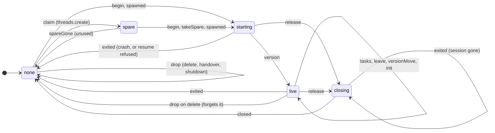

# Runner protocol: Updates and restarts

Part of the runner protocol. [docs/protocol.md](../protocol.md) has the rules for all of it and which file each section is in.

## Runner updates

`hello` carries `updates?: RunnerUpdates`, and `runner.updates` sends it
again whenever it changes, so a client can show that the runner is
updating itself (docs/dev-tools.md, "The runner updating itself").

```ts
type RunnerUpdates = {
  // The runner following main (runner.status's update.state).
  state: "off" | "idle" | "checking" | "building" | "waiting" | "failed"
  commit?: string       // main's short commit it last saw or is building
  subject?: string      // that commit's subject line
  reason?: string       // off: why; failed: what went wrong
  // Runners that handed over and are still finishing turns (Handovers).
  oldRunners: { version: string; threads: string[] }[]
  // The LaunchAgent is behind main in a way only install-runner.sh fixes:
  // launch.mjs on main differs from the installed one, the plist still
  // runs node rather than Threadbear Runner.app, or the app was built
  // from older runner/launcher/ sources than main's.
  launcherChanged?: true
  // Which of those, in a sentence (for tb status and the Updates panel).
  launcherReason?: string
  // The checkout this runner follows, whose install-runner.sh a reinstall runs.
  checkout?: string
  // What's being done about launcherChanged (runner/src/reinstall.ts). Left
  // out while nothing is: the app offers Update it (runner.reinstall).
  // waiting: about to start (auto: the runner does it by itself, rather
  // than because Update it was pressed; from a
  // runner of 14 Nov, waiting for busy threads);
  // running: install-runner.sh --stage is going, as a launchd job of its own;
  // staged: in place, but what's running is still behind until launchd next
  // starts the job (the Mac restarting); nothing more to do until then;
  // failed: it stopped, `reason` says why and `logFile` has its output.
  // A failure is Mike's to look at (Try again); the rest sort themselves out.
  reinstall?: { state: "waiting" | "running" | "staged" | "failed"; reason?: string; logFile?: string; auto?: true }
  // Set with launcherChanged by runners whose runner.reinstall stages (from
  // 15 Nov 2026). Without it the app offers no button and says nothing
  // about it stopping nothing: the runner of 14 Nov reinstalled once idle.
  launcherStages?: true
  // This machine can't follow GitHub's main properly (followOrigin), and the
  // other runners saying that of themselves, on the main Mac's runner.
  followProblem?: string
  // This release's CEF pin is over 14 days behind stable, or the daily
  // check has failed for 3 days. Also on runner.status as webRuntimeProblem.
  webRuntimeProblem?: string
  // Over 14 days behind stable, but no cef-rs bindings exist for anything
  // newer, so nothing can be done yet (from 24 Nov 2026). A quiet line in the
  // Updates panel: it doesn't show the Updates icon or go in its tooltip.
  webRuntimeNote?: string
  behindRunners?: { name: string; problem: string }[]
  // Mike's releases, for a fork (below). Left out while off, except on
  // Mike's own runner once it has tagged one.
  upstream?: UpstreamStatus
  // A fork's own changes to the old Swift app not yet rebuilt in the GPUI
  // one ("Your changes to the old app", below). Left out while there are none.
  swiftChanges?: SwiftChanges
}
```

### Mike's releases

A copy of Threadbear that's someone's fork follows Mike's releases
(`runner/src/upstream.ts`, docs/setup-and-updates.md section 2.3). Every six
hours, and a couple of minutes after the release is marked good, the runner
lists `upstream`'s `release/*` tags (`git ls-remote`) and fetches only a
few of them: tag objects named for a date no later than two days from now,
the newest 20 from the newest release already kept on (passing over any it
already found unsigned) and the newest 9 before it, for their notes. They
go into a folder of their own under `<home>/runner/upstream-fetch`, never
the checkout: their objects through git's `GIT_OBJECT_DIRECTORY`, with no
ref of the checkout's changed. They're read and verified there, and only
one that verifies is copied into the checkout, as
`refs/threadbear/upstream/<date>`; the newest there is the release. The
folder is deleted when the check ends, however it ends, so a tag that
didn't verify, or a fetch cut short, leaves nothing in the checkout. Every
git command has a deadline (two minutes, five for one that talks to a
remote) and is stopped with whatever it started, and the check fails and
says so. Every git command it runs, and Mike's runner's publishing below,
is release git (`upstream.ts`, Daybreak 179 and 180, 24 Nov 2026), as the
checkout's `.git` may have come with an archive or a shared drive, or be
the one a thread's worktree shares: none of the runner's `GIT_` variables
but who commits; no system or global config for a fork's check (Mike's
publishing keeps his, for his signing setup and the push to GitHub); every
setting in the checkout's own config that would run something switched off
on the command line just before each command (`safe-git.ts`
`repoProofConfig`: hooks, fsmonitor, filters, diff drivers, credential
helpers, ssh and askpass programs, protocols it allows; and signing
programs, `log.showSignature`, push signing and submodules; the ssh
command, signing programs and credential helpers are set to the owner's
own or git's defaults every time, whatever the checkout's config says, and
a setting whose name isn't UTF-8, which `-c` can't name, stops git); only `https`
and `ssh` to a remote, with git's own upload-pack and receive-pack named;
and the remote given as a URL rebuilt from `remote.<name>.url` as
configured, an https or ssh address of a plain host and path (anything
else, a folder, `file://`, `ext::`, or more than one address, and upstream
counts as off; a user and password in it are left out). A checkout whose
own config rewrites an address (`url.*.insteadOf`, `pushInsteadOf`),
configures a remote named by a URL (which git looks a URL up as), or sets
anything under `http.` (a proxy, certificate checks) isn't used
for network git at all: the check fails, and Mike's runner holds its
release, saying which setting. Replacement objects, grafts and the
commit-graph are off (`GIT_NO_REPLACE_OBJECTS`, `GIT_GRAFT_FILE=/dev/null`,
`core.commitGraph=false`), and a checkout with a `refs/replace/` ref or an
`info/grafts` file isn't checked at all: the check fails and says so, and
Mike's runner holds its release with the reason. A release's
`scripts/release-signers` and `scripts/release-keys-revoked` are read
object by object from the signed commit (commit, trees, blob), each one's
bytes hashed and checked against its id, so a forged object fails the
check rather than counting, and so does one it names that can't be read. A runner from before 7 Nov 2026 fetched every tag into
`refs/threadbear/upstream-incoming/*`, unchecked; each check deletes
anything left there. Verified
means: the tag object is `object`, `type commit`, `tag <the name it came
in as>` and `tagger` headers, a message, and exactly one SSH signature
block at the end, with no other armor at the start of any line; and
`ssh-keygen -Y verify -n git` finds that signature good, over the bytes
before it, for a principal in `<home>/upstream-signers`. It never uses
`git verify-tag`, which would hand a PGP or X.509 signature to gpg. Each
check first (before the fetch, so a failing upstream can't stop it)
removes any ref in `refs/threadbear/upstream/*` that doesn't verify (a
runner from before this check fetched straight into it). A tag object over
1 MB is never read and doesn't verify. Only tag objects
whose names are a date (`release/YYYY-MM-DD`, as Mike's runner makes
them), no later than two days from now and no earlier than the newest
release already kept, are looked at, newest first, stopping at the first
that verifies, and at most 20 not read before per check, so a flood of
tags upstream costs a check almost nothing. Each tag object's answer is
remembered while the runner runs; a read or an ssh-keygen that fails to
run fails the check instead, and is tried again next time. A name in `refs/threadbear/upstream/*` keeps the tag it verified
with: a different tag served later under that name is left out and logged. A
verified tag counts only if its commit is on upstream's `main`, fetched
with the tags into the same folder (`refs/incoming-main/main` there): a
release whose commit isn't (a side branch, or a main moved away from it)
is never kept, and one kept before is passed over. The release keys
change only through the newest release that counts
(`runner/src/release-keys.ts`): a key in its commit's
`scripts/release-signers` that isn't pinned waits a week from when this
runner first saw it (in `<home>/upstream-keys.json`), and is dropped if
the key that announced it is revoked first; then it's added to
`<home>/upstream-signers`. A key in `scripts/release-keys-revoked` is
taken out at once and kept in `<home>/upstream-revoked`, which
`ssh-keygen -Y verify` is given with `-r` on every check and which setup
honours too, but only if that release was signed with the key itself or
with one pinned after it. A signature may also come from a weekly key
whose OpenSSH certificate a pinned key made (Mike's, since 25 Nov 2026:
release-keys.ts, "Releases signed by a weekly key"): each pinned key also
counts as a `cert-authority` for its principal, for the git namespace, and
such a signature is checked at the tag's own tagger time
(`-O verify-time`), which must fall on the UTC day the tag's name says
and be no more than an hour ahead of the fork's clock, so the
certificate's week bounds the names it can sign, and a leaked one can't
name tomorrow's release today (nor one after the fork's UTC day). Only
that failure (dated ahead of the fork's clock), or a key file that can't
be read yet, isn't remembered, as it may pass later. Release names must
have a month 01-12 and a day 01-31. A certificate for
any key type but ed25519 is refused. The certificate carries, in its
`threadbear-keys@threadbear` extension, the SHA-256 of the
`scripts/release-signers` and `scripts/release-keys-revoked` its
authority vouched for (with a NUL between them), and a release it signs
counts only if its commit has exactly those: so a weekly key can't change
which keys count, its release's key changes are its authority's, and each
one carries the whole list, so a fork that was away takes every change
from the next. Any release may revoke a key that was never pinned (a
weekly key), which goes in `<home>/upstream-revoked-weekly` (ed25519 keys
only) and is checked against the key a certificate certifies, never its
authority. Revocations are read from every release a check fetched that
verifies and is on upstream's main (by tag object, so a same-day
replacement counts), not just the newest, so a newer release signed by a
revoked key can't hide the one revoking it; when one does revoke
something, the check looks again before the newest says anything. A
weekly key's release is taken only while its certificate is good by the
fork's own clock (as well as at the tag's time); once kept, it stays. So a
weekly key that leaked is good for its week at most, however the tags
upstream are arranged. One whose week ended before the fork saw it is
passed over from then on, so older releases stay in reach. An older
release read for its revocations never lets a waiting key in. Mike's runner waits for
UTC's day only on its hourly look: `tb updates publish` signs with the
release key then.
`release.commit` is the commit
the verified tag names, and that is what a bring-in merges. It never
changes main: bringing a release in is a thread (docs/bringing-in-updates.md).

```ts
type UpstreamStatus = {
  // off: no upstream remote, upstream is the same repo as origin, or no
  // pinned key; idle: main has the newest release; available: it doesn't.
  state: "off" | "idle" | "checking" | "available" | "failed"
  reason?: string          // off and failed: why; idle: "no signed releases yet"
  checkout?: string        // the repo it looks at (the release's checkout)
  checkedAt?: string
  release?: {              // the newest signed release, kept through a failed check
    tag: string            // "release/2026-10-30"
    commit: string
    date?: string          // the tag's, ISO. Clients show a release's day from
                           // this, in their own timezone: the name is the day on
                           // Mike's runner, a day ahead of America's afternoons
    changes: number        // commits in it main doesn't have, merges left out
    subjects: string[]     // their subject lines, newest first, at most 50
    // Commits in it with an `Important:` trailer (a security or data fix),
    // and the trailer's text; covered by the tag's signature.
    important?: { commit: string; why: string }[]
    // Each signed release main does not have, newest first: plain-words
    // notes, or its commit subjects when it was tagged without notes.
    // `date` is that tag's, as the release's own
    notes?: { tag: string; date?: string; lines: string[] }[]
    // The What's new page's cards for those releases, when upstream is a
    // repo with a page (runner/src/changelog.ts: Mike's) and the runner
    // could read its /changelog.json at this check. Not signed: something
    // to look at only, so clients fall back on `notes`, and show the notes
    // of a release missing from `releases` (its entry comes hours after
    // the tag). `picture` is always an https file on the page's site.
    changelog?: {
      page: string                // https://threadbear.mikecann.app/changelog
      releases: {
        tag: string
        link: string              // that release on the page (#2026-11-16)
        highlights: { kind: "added" | "changed" | "fixed"; title: string; text: string; picture: string; clip?: true }[]
        added: number             // its plain lines besides the cards
        changed: number
        fixed: number
      }[]
    }
  }
  // Mike's runner (runner.json releases.publish): the last tag it made.
  published?: { tag: string; at: string }
}
```

`upstream.status` returns `{ upstream: UpstreamStatus }`, and
`upstream.check` fetches first and then returns the same (`tb updates
[check]`). `runner.status` carries it as `upstream`.

`upstream.publish` (Mike's runner, `tb updates publish`) tags and signs
today's release now, without the hour main and the runner must otherwise
sit still, and with a Touch ID key asks at once rather than waiting to see
him at the Mac. GitHub's checks still pick the commit: the tip if green,
else the newest green one since the last release. It returns `{ tag?:
string, upstream: UpstreamStatus }`: no `tag` when nothing went out, with
`upstream.held` saying why.

After each check that finds a release main doesn't have, the runner may
start a thread to bring it in (`runner/src/bring-in.ts`), as Bring Them In
would: titled "Bring in Mike's release of 6 Nov", in the release's checkout,
full access, `startedBy` `{ kind: "runner", label: "Threadbear" }`. It does
so once `releases.bringIn` days have passed since the last one started (or
since it first looked), straight away for a release with an important commit
it hasn't acted on, and never with `"off"`. While the last thread it
started is still there and not archived, it sends that thread a message
about the newer release instead, on the same timer, so there's never more
than one. What it last did is in `<home>/runner/bring-in.json`.

Mike's runner makes the tags when runner.json has `"releases": { "publish":
true, "signingKey": "~/.ssh/<key>" }`: once an hour it looks, and tags
main's tip as `release/<local date>` (SSH-signed, its message the subjects
since the last release) and pushes it to origin, when there's no tag for
today, main has moved since the last one, main's tip is an hour old, and the
runner it's running is main's runner/, marked good and up for an hour.

With `"delegate": true` and a Touch ID key, it signs with a weekly key
instead (`runner/src/release-delegate.ts`), so a release doesn't wait for
Mike at the Mac: a plain ed25519 key in `<home>/runner/release-delegate`,
with a certificate from the release key good for 8 days
(`release-delegate-cert.pub`). With 3 days left, the hourly look asks for
Touch ID to make a new one when he's at the Mac (at most once an hour;
`tb updates publish` asks at once), checks a signature made with it
verifies before putting it in place, and with 36 hours left and still not
renewed starts a starred thread asking him to (its id in
`release-delegate.json`, one at a time). The weekly key is used only once
the last release's `runner/src/release-keys.ts` has the check that takes
it, with two days or more left (forks take its release only within its
week), when its key file and the release key
match its certificate, when it isn't revoked, and when it vouches for the
release's key files (a key change needs a new one, with a touch), and when
this Mac's day is UTC's (in Perth, from 8am; before then it waits);
otherwise the release key signs, as before (and a key that doesn't fit is renewed
next time). When main hasn't moved but the last release was a weekly key's whose
week ends within two days, the same commit goes out again under today's
name, so a fork that missed it still has one it can take. `tb updates
publish` says until when the weekly key signs, or why renewing it failed.
Known limit: while main stays red for longer than a weekly key's week,
nothing new goes out, and a fork that missed the last weekly key's
release waits for the next green commit's.

### Your changes to the old app

Someone's fork may have changed the Swift Mac app (`app/`, `dock/`) before
it froze. The GPUI app is different code, so those changes can only be
rebuilt in `desktop/`, not copied (`runner/src/swift-changes.ts`).

Theirs means a commit on the checkout's `main` that touches `app/` or
`dock/` outside what the GPUI app used from there before that moved out on
21 Nov 2026 (`GPUI_SHARED`), isn't a merge, isn't reachable
from upstream (`refs/threadbear/upstream/*` and `refs/remotes/upstream/main`),
and doesn't share its author, author date and subject with one of
upstream's (a cherry-pick of Mike's, or a fix of theirs he took). In a copy
whose `origin` is mikecann/threadbear, or with nothing of upstream's to
compare with, it's `off` and finds nothing. A change is done once a commit
on `main` that upstream doesn't have carries a `Ports: <commit>` trailer
naming it (seven or more hex digits), or once it's dismissed. A commit that
changed `desktop/` as well as the Swift app was made in both apps at once,
so it isn't listed.

```ts
type SwiftChanges = {
  state: "off" | "ready" | "failed"
  reason?: string     // off and failed: why
  checkout?: string
  changes: {          // newest first, at most 100
    commit: string; short: string; subject: string
    date: string      // the committer's, ISO
    files: string[]   // its files in app/ and dock/, at most 12
    moreFiles?: number
    threadId?: string // an open thread rebuilding it
  }[]
}
```

The first `hello` from `client: "threadbear-desktop"` on a runner looks,
once (`<home>/runner/swift-changes.json` records it): when there are
changes it starts one thread in the checkout, titled "Bring your changes
to the new app", `startedBy` `{ kind: "runner", label: "Threadbear" }`, on
the install's default mode, that says in plain words what they changed and
asks before rebuilding anything. Later hellos look again (at most once a
minute), as do an hourly timer and each check for Mike's releases.

| Request | Params | Result |
|---|---|---|
| `swiftChanges.list` | `{}` | `{ swiftChanges: SwiftChanges }`, after looking again |
| `swiftChanges.port` | `{ commit }` | `{ threadId, thread?: ThreadSummary, swiftChanges }`: starts a thread to rebuild that one change, or returns the open one already on it. `thread` is its summary, so a client can open it before `threads.updated` reaches it. `-32602` for a commit not on the list |
| `swiftChanges.dismiss` | `{ commit, undo?: true }` | `{ swiftChanges }`: leaves it off the list from now on, or with `undo` puts it back |

"Pending" for a client means `building`, `waiting`, any `oldRunners`, or
`launcherChanged`; `failed` is worth a look too, and `followProblem` or
`behindRunners` want someone (nothing fixes those by itself). `waiting` is brief once
handovers are on: the release is built and the switch starts as soon as
the restart is asked for.

## Restarts

`runner.restart` restarts the runner without cutting a turn short.

- `when: "idle"` (the default) waits until no thread is starting, running or
  waiting on an approval or a question, and no CLI is still running
  background shells or subagents (stopping the runner stops those too).
  Then it shuts down the way it does on SIGTERM and exits 0, and launchd
  starts it again. `waitingFor` names the threads it is waiting for. A
  message sent meanwhile still starts a turn, and the restart waits for
  that turn too. Background work can go on for ever (a dev server, a
  watcher), so `backgroundWaitMs` puts a limit on it: from then on only
  turns hold the restart, and the background work it stops gets the note
  below. A thread deleted meanwhile stops holding it. Turns are never cut
  short by an idle restart. When background
  work ends while a turn is running, the thread stays busy for up to 15 s
  after that turn, since the CLI may start a turn of its own to read the
  result. Once the shutdown has begun, `threads.send` and
  `threads.create` answer `-32020` ("The runner is restarting; send again
  in a moment.").
- `when: "now"` shuts down straight away. Turns in flight end as `stopped`.
  Whenever the runner stops with background work still going, each thread
  that had some gets a `system.note` saying what was stopped.
- While a restart is pending, every client gets a `runner.notice` ("The
  runner will restart when 2 threads finish."), and clients that say hello
  get it again. Threads waiting on an approval or a question won't finish
  until someone answers, so they're counted apart: "The runner will restart
  when 1 thread finishes and you answer 2.", or "when you answer 1 thread."
  The Mac app reads these sentences (the numbers after "when" add up to the
  threads waited for), so they change together. `runner.status` shows it as `pendingRestart`. When it
  starts, the notice is "The runner is restarting now."
- The runner asks itself for an idle restart after an uncaught error
  (reason "An unexpected error (see the runner log)"; runner/README.md,
  "Restarts"), so clients see the usual notices. A handover's notice says
  "onto a new release" only when the request named one. After 3 of these in
  10 minutes it stops restarting for them and sends a `runner.notice` at
  warning level, again after each hello, until an hour passes without an
  uncaught error.
- The request is saved in `restart.json` in the data dir, so a crash
  before the runner is idle doesn't lose it: the next start counts as the
  restart. If the runner stops some other way while it waits (launchctl,
  a reboot), that stop counts as the restart. Asking again while one is
  pending merges the two: `now` wins, the earliest background limit
  wins, and each thread's latest `resume` is kept.
- `cancel: true` withdraws it. If it was a deploy's restart onto a release
  that `current` names and this runner isn't running, the runner points
  `current` back at its own release, so the withdrawn release doesn't
  start on the next restart of any kind; `note` says so (or, when it
  can't, that the release is still current).
- `resume` carries a thread on afterwards. On the next start the runner
  adds a `system.note` "Runner restarted: <old version> to <new version>"
  to that thread (with " (from branch X)" for a release not built on main,
  and the rollback notice below as a second paragraph if the new release
  kept crashing), then sends `text` as a new turn whose `user.message` has
  `origin: "runner"`. The text is only sent if the old runner stopped less
  than 15 minutes ago (after a crash, if that thread asked less than 15
  minutes ago), the thread isn't snoozed or archived, nobody has sent it a
  message since it asked, and the runner hasn't already resumed it 3 times
  in the last hour; otherwise there's only the note, saying why. A
  resume sent again after a crash rollback (below) replaces the one the
  crashed release sent, so it doesn't count twice.
- If the request named a `release` and the runner came back on another one
  (it kept crashing, or a later deploy replaced it), the note says so and
  the text sent starts with "Note from the runner: ..." saying which
  release is running, so the agent doesn't take the old code for its own.
- The handled request is kept as `restart.done.json` until the new runner
  has stayed up 60 seconds or stops cleanly. If it crashes before then,
  the same release starting again leaves the file alone (launch.mjs gives
  a broken release a second start), and when launch.mjs then goes back to
  the last good release, that runner resumes the same threads once more,
  with the rollback in the note and the message.
- A runner that had to go back to an earlier release because the new one
  kept crashing at startup says so with a `warning` notice at startup and
  after every `hello` ("Release X kept crashing at startup, so the runner
  went back to Y.").

### App restarts

The GPUI app waits until main's `desktop/` tree has stayed the same for
runner.json's `updateQuietMinutes` (two by default, three on Mike's Mac)
before requesting an update build. Landings outside that tree do not
restart the wait. It observes changes during a build too, keeps one build
at a time, lets a staged version go in before building another, and considers
only the latest tree afterwards. Automatic remote update builds go ahead of
other work waiting on the host (`THREADBEAR_REMOTE_FIRST`): each trusted host
is tried without queueing, then the first busy one is waited on, the build
going next. A build already
running keeps its leases until its work and cleanup finish. Only
`updateBuildHosts` can supply the binaries, as before.

An agent that changed the Mac app lands it; the app restarts onto the new
build by itself once Mike leaves it idle, or sooner if he picks Restart to
Update. The agent wants to know when it has, to check the change in the
running app. The app's `hello` carries its `build` (`commit`, `short`, and
`tree`: the Swift app's app/ and dock/ trees as `BuildInfo.appTree`, the
GPUI app's desktop/ tree from its bundle's build.json; a dev build sends
none). Only `client: "threadbear-mac"` and `"threadbear-desktop"` count,
each followed on its own, so one reconnecting on the build it had isn't the
other restarting. The runner keeps the last build it saw of each and the
threads waiting, in `app-restart.json` in the data dir, so both outlast its
own restarts.

- While a thread is on the list (and asked under a day ago), its summary
  has `awaitingApp` (`{ commit?, short? }`, the commit it waits for), so
  the GPUI app's Updates panel can list it with whether its running,
  staged or building version has that commit (`git merge-base
  --is-ancestor` in the checkout it follows).
- `wait_for_app_restart` (`{ text?, commit? }`) puts the calling thread on
  the list, remembering the build running then and the commit the new build
  must contain: `commit` if given, else main's HEAD at that moment. Main
  is looked up in the Threadbear checkout the apps are built from, then
  the thread's folder; a `commit` in the thread's folder, then that
  checkout (so `HEAD` is a worktree's own, and a thread in another repo
  can name a Threadbear commit). A `commit` found in neither is refused with an error, rather
  than waiting for any new build, and drops the request it had. Asking
  again replaces its request. Its `text` is kept with a ceiling, the
  thread's saved mode as it asked (`runner/src/runner/ceiling.ts`): raised
  above that by the time the app restarts, the thread gets the note and
  goes to Needs you, and its agent doesn't get the text.
- A turn that ends needing nothing (no archive, snooze or waitFor) while
  its thread is on the list hibernates the thread for a day at most
  (`system.note` "Hibernating until the Threadbear app restarts onto the
  new build, a day at most."), as it isn't done: the restart's message
  wakes it. One that needs Mike stays in the inbox.
- An `end_turn` with `needs: "you"` whose asks mention "Restart to Update"
  (in `action`, `why` or `where`) does the same, unless the thread is already on
  the list, and its reply says so. So does a completed turn whose
  closing "What I need from you" says it, for when end_turn was refused
  and the asks ended up in the reply's text.
- When an app says `hello` with a `tree` other than the one a thread
  remembered for that app, that thread gets a `system.note` "Threadbear app
  restarted: <old short> to <new short>" ("Threadbear GPUI app" for the
  GPUI app's) and a message with `origin: "runner"`: "The
  Threadbear app has restarted onto <short> (<commit>), as you asked to
  hear." and its `text`, or "Check your change in the running app.". Then
  it's off the list. The same build again (the app reconnecting to a
  restarted runner) changes nothing. A new build whose `commit` doesn't
  contain the thread's commit (`git merge-base --is-ancestor` in the repo it was found in:
  a build staged before the thread landed) keeps the thread on the list,
  now from that build, with a `system.note` "<app> restarted onto <short>,
  which doesn't have <commit> yet. Still waiting." A build whose `tree`
  is that commit's tree for the app (main moved on with other changes
  before the thread asked) counts too. When git can't tell (a build commit
  neither the thread's repo nor the apps' checkout knows) the thread stays
  on the list from that build too, noted "...and git can't tell whether
  that has <commit>"; when it's too slow to answer, it stays on the list as
  it was and the next `hello` asks again. Only a request with no commit at
  all (none could be resolved) takes any new build. A build a thread on a draining runner was due to hear about is
  forgotten when the same app comes back on any other build (rolled back,
  or one without the commit); if that one counts, it hears about that. A thread that remembered only one app's
  build waits for that app: the other's first `build` isn't a restart of it.
  One that remembered neither (no app had said) takes either.
- An archived thread, or a request more than a day old, gets only the
  note, saying why.
- A thread still finishing a turn on a draining runner (Handovers) stays
  on the list until it comes across, and then hears about the build the
  app came back on. One that has been deleted just drops off the list.

### Handovers

A runner started by `launch.mjs` as a supervised child
(`THREADBEAR_SUPERVISED=1`, docs/dev-tools.md) doesn't make an idle
restart wait for busy threads. It hands over instead:

- If no thread is busy, it restarts as above.
- Otherwise the busy threads (the ones an idle restart would wait for,
  background work included) are *kept*, and `launch.mjs` starts the new
  release beside this one. `runner.restart` answers at once with
  `waitingFor: []` and `handover: { keeps: string[] }`.
- The old runner is now *draining*. It stops listening on the runner's
  port, lets go of every thread it doesn't keep (their idle CLIs exit and
  resume by session id on the new runner), stops its schedules, updates
  and CLI installs, and listens on a port of its own on 127.0.0.1, written
  to `run/drain-<pid>.json` as `{ pid, port, version, release?, since,
  threads: string[], auth: "challenge" }`. Same token, and the same
  challenge (see Auth; `auth` is absent from a runner older than it).
- The new runner (the *primary*) reads those files at startup, connects to
  each, and doesn't load the kept threads itself. Clients only ever talk to
  the primary: a request about a kept thread (`threads.send`,
  `threads.events`, `threads.subscribe`, `approvals.respond` and the rest)
  goes to the draining runner and its answer comes back unchanged, and the
  draining runner's `thread.updated`, `thread.event`, `thread.deleted` and
  `runner.notice` come through the primary. `threads.list`,
  `threads.search` and `hello` include kept threads.
- The draining runner's sync stops at the handover, and the primary only
  hears its events from then on. So the primary's sync starts listening
  but holds its writes while it asks the draining runners for the cards
  nothing has answered on each kept thread, every thread at once
  (`drain.openCards { threadId }` → `{ events }`, the thread's open request
  events oldest first, worked out from its whole log there a chunk at a
  time, so no log crosses the connection; `moved` for a thread it no
  longer keeps), within 5 seconds: a thread not read in time, or not at
  all, costs only that thread its card, not the others or the
  startup. A runner from before `drain.openCards` answers it "method not
  found", and its logs are read instead, a thread at a time so only one
  page is out on the connection (`threads.events`, a page at a time from
  the end). It puts them back on
  the thread's row and marks every thread it read, then writes
  (`Peers.openCards`, `ConvexSync.seedCards`, `release`). A card asked for
  or answered on the draining runner later reaches the row with the
  `thread.updated` that follows it, written straight away even while the
  sync settles, never from the summary it had before (which may say
  idle). Without this the row went up with no card while the thread still
  waited on one: another Mac's view takes a card gone from the row as
  answered, so the thread sat in the inbox needing Mike with nothing to
  answer (13 Nov 2026, a cloud runner's request to start a thread on the
  main Mac).
- A kept thread moves across once nothing would be cut short: no turn,
  approval or question, background work or wake grace. Background shells
  and monitors hold it for 4 hours after its last turn at most (a dev
  server never ends), and are then stopped with the usual note, and the
  thread is told when it comes across (Stopped background work). A thread
  in use could stay on the old release for as long as its work runs, so
  once it has been there 12 hours, 30 minutes without a turn is enough.
  A card (approval, question, secret) holds it only so long: once a kept
  thread has had nothing else going for 30 minutes
  (`DRAIN_CARD_WAIT_MS`) with its cards still open, counted from when the
  draining runner first saw each, they lapse (`approval.resolved` with
  `expired`, so no app offers them and a late `approvals.respond` is
  refused as no longer pending), a `system.note` says so, its turn is
  stopped, and a message from the runner queued behind it goes across with
  it, so the new runner starts a turn telling the agent to ask again.
  Before this an unanswered card held an old runner open for good (26 Nov
  2026: two for 9 and 11 hours).
  The stuck-job check (Stuck background jobs) goes on running on the
  draining runner, for the threads it keeps. Subagents
  hold it until they finish, up to 4 hours: they end by themselves, and
  stopping one throws its work away. Messages queued for it at that moment move with it
  and the primary starts them, so a message sent during the turn runs on
  the new release. The exception is a thread that background work is
  holding: a message to it, or one still queued when its turn ends, starts
  a turn on the draining runner straight away rather than wait out the
  work, and the hold counts from the end of that turn. The draining runner saves the thread, then sends the
  primary `drain.handedOver { threadId }`; the primary loads it and carries
  on (the same seqs; a client's subscription keeps going). Once it keeps
  nothing, the draining runner exits.
- A request for a thread the draining runner has already let go answers
  `-32030` ("moved"), and the primary handles it itself.
- It lets the idle threads go before it stops listening on the runner's
  port, so for those few seconds a client's request about one of them
  there answers `-32020` "The runner is handing over to a new one; try
  again in a moment." rather than "Thread not found". The Mac app sends a
  `threads.send` or `threads.update` (archive included) turned away like
  that (or with "Thread not found" from an older runner, while a restart
  is on) again once it's connected to the new runner, and holds back any
  it makes meanwhile until those have gone, so they land in the order
  they were made.
- The threadbear tools in a kept thread's session reach the primary over
  the runner's port for anything about other threads, its schedules and
  its projects. A lookup of one thread there is `threads.list` with `ids`:
  `list_schedules` looks up every schedule's thread at once, and when each
  lookup listed every thread (2.8 MB with 931) the answers piled up past
  the primary's 32 MB limit and it closed the link (7 Nov).
- Projects belong to the primary, which owns `projects.json`. A kept
  thread's project tools read and change them there with
  `drain.projects { op, args }`: `op` is the `Projects` call the tool
  would have made on its own runner (`list`, `get`, `find`, `create`,
  `update`, `editNotes`, `appendNote`, `addLinks`, `removeLinks`, `changeMembership`,
  `chooseIcon`), with the same `args` and the agent as the maker, and the
  answer is `{ result }`. A primary older than this answers `-32601`.
  Joining or leaving changes the thread itself, so for a thread the
  draining runner keeps (`create` with `threadIds` included) that part
  happens on the draining runner, against the primary's copy of the
  project, and moves across with the thread. Until the draining runner
  knows the primary's port, a change is refused with a "try again in a
  few seconds" error.
- A `resume` for a kept thread is sent when the thread moves across,
  rather than when the new runner starts, and the 15-minute limit counts
  from then.
- If a connection or setup call to a draining runner fails at startup, the
  primary retries while that process lives and its drain file is there, for
  up to 30 seconds across all draining runners (each gets 10 at least, and
  nothing goes past 60; one attempt takes at most 10). Retries log at info;
  giving up logs the last failure as an error. If the runner still can't be
  reached, startup fails with its drain file and process groups untouched: a
  timeout alone never permits taking its threads. One that removed its drain
  file meanwhile finished cleanly, and isn't reported. On Windows, where a
  pid can't be told from any other node's, a failed connection is tried
  once and the runner taken as gone, as before retries.
- A thread handed over while startup is still reaching draining runners is
  kept from start and taken in just after it, never if startup gives up; one
  handed over to an attempt that failed is left on disk for start to load.
- If a draining runner dies, the primary takes its threads as after a
  crash (a turn in flight ends as `stopped`) and stops the process groups
  it left (`run/children-<pid>.json`).
- `runner.status` on the primary lists draining runners as `draining: {
  pid, version, release?, since, threads: string[] }[]`.
- `when: "now"` restarts the primary straight away and tells each draining
  runner to stop too (`drain.stop`).
- Another handover while one is draining makes the primary a draining
  runner as well; draining runners don't hand over again, and close their
  own connections to older ones, which the new primary connects to.

- The primary's summaries of kept threads carry `onOldRunner: true`, so a
  client can say a thread is finishing on the old release. The flag goes
  when the thread comes across.
- Usage readings from kept threads' turns go to the primary
  (`drain.usage { accountId, reading }`), which owns `usage.json`.
- The runner's notice when it hands over starts "The runner is restarting
  onto a new release", which clients already read as a restart under way.

The methods between runners (`drain.hello`, `drain.openCards`,
`drain.stop`) and
`drain.handedOver`, `drain.usage` and `drain.projects` are for runners only.

### Stopped background work

A handover's limit (above) or a runner stopping ends a thread's background
shells, monitors and sub-agents. The `system.note` saying so wakes nobody,
so a thread that promised to report back would just go quiet. So the runner
saves what it stopped on the thread (`stoppedWork` in thread.json), and the
next one tells the thread: when it comes across from a draining runner, or
once a restarted runner is listening. That's a new turn whose `user.message`
has `origin: "runner"`, naming the jobs and saying to check on them, report
back if it said it would, and use `schedule_message` for a long wait.

- Only those two kinds of stop count. Snoozing, archiving, moving or changing
  a thread stops its work because someone asked, and the note is enough.
- A thread archived or snoozed by the time it would be told is left alone.
- A runner away for more than a day, or a thread woken 3 times for this since
  a message came from anyone but the runner, gets a `system.note` "Not waking
  this thread about its stopped background work: <why>." instead. The third
  wake says it's the last.
- A crash stops the work without saying what it was, so nothing is told then.

### Stuck background jobs

A thread whose turn has ended stays in Running while its CLI still has
background shells or sub-agents going, so a job that can never finish
(a wait loop whose `pgrep -f` matches its own shell, say) keeps it there
for good. Every 5 minutes the runner (stuck-jobs.ts) looks at idle Claude
threads with background work. A shell or sub-agent counts as stuck when
its output file under `/tmp/claude-<uid>/<project>/<session>/tasks/` (a
sub-agent's links to its transcript) was made more than 30 minutes ago
and hasn't been written for 30 minutes, and, for a shell, it and
everything under it used under 2 seconds of CPU between two looks. The
shells are found under the thread's CLI (the process whose arguments
carry `--resume=<session>` or `--session-id=<session>`) and matched to
their jobs by the output file on their stdout. Monitors are left alone;
they sit quiet by design. So is a shell running a command that waits on
Mike: a `browserbear handoff … --wait` (or `--until-url`,
`--until-text`) process under it, read from ps's full command lines the
way browserbear reads its flags. A shell whose own text only mentions
one doesn't count. It's left alone until its own `--timeout` (20 minutes
when not given) plus 5 minutes has passed since that process started
(ps's etime), and judged as usual after that, as it should have exited
by itself by then. The first wait the check sees sets that deadline for
the job, so a loop that keeps starting new handoffs can't put it off. A
shell with a `tb land` process under it (`node …/tb land`, not a shell
that only names it) is left alone the same way, for three hours from when
that process started: it sits silent with no CPU while it waits its turn
for the landing lock, or while its check runs on another machine, and
stopping one sends it to the back of the line and throws away the group
check it was running (13 Nov: a dozen threads were told theirs looked
stuck, and nothing landed for 35 minutes). That's asked at every look
rather than kept: once the landing has gone, what's left is judged as
usual, and the three hours count from the first landing seen under the
job. Any other quiet job of the thread's (a loop polling the landing's
log, a sub-agent waiting on its own `tb land`) is left alone while that
landing is within its three hours too: nothing ties the two together, and
the agent was told once per copy of a sub-agent's repeated wait loop, so
the same notice seemed to come four times (19 Nov). Once the landing has
gone or run past its time, they're judged as usual. Codex's background terminals leave no files,
so Codex threads aren't looked at.

The thread gets one message from the runner (origin `runner`) listing
its stuck jobs, with each one's task id (copies of one job share a
description), how long it has run and what's running in it, asking
the agent to stop any that are stuck and to ask Mike if it can't tell.
Jobs it has been told about are kept in `stuck-jobs.json` in the data
dir for a day, so a runner restart doesn't tell it again.

### Background wait loops

A thread can't be hibernated while its CLI runs background jobs without
stopping them, so an agent that waits on something outside its turn (a
merge to land, CI, another thread, a time) with a background shell that
sleeps until it's there keeps its thread awake: on 17 Nov a "wait until
this Mac's main has Ian's commit" loop sat for 40 minutes, and Hibernate
asked to kill it. The Claude adapter's PreToolUse hook (wait-loops.ts)
refuses such a call as it's made, in every mode: a Bash call with
`run_in_background` whose command has a `while`, `until` or `for` loop and a
`sleep` from there on, a `sleep` of a minute or more by itself, or `gh run
watch` / `gh pr checks --watch`; and a foreground one whose loop sleeps 30
seconds or more between looks, or that sleeps a minute or more, as the CLI
moves a command that hits its timeout to the background (a quick poll there
is a server coming up, and a CI watch is a turn waiting for its own
checks). Quoted text and a heredoc's body aren't read as code, except a
shell's `-c` script (`bash -lc` too), ssh's remote command, a `"$(…)"`
substitution and a heredoc a shell or ssh reads; a quoted number is kept,
so `sleep "60"` is still a minute. The text is read in linear
time, as the hook runs on the runner's event loop. The reason tells the agent to wait
with `schedule_message` on a cron (a one-off whose check prints nothing is
done for good, which would drop the wait) and a `check` that prints once
it's ready, then end its turn with `snooze`, so the thread hibernates and
the check wakes it. A
short wait it will use within its turn (a server starting) goes through
when the command carries `# short wait`. Codex's shell has no hook to
refuse a call with, so Codex threads are left to the stuck-job check.

### Waiting on its own shells

A turn that ends with no say at all (no `end_turn`, nothing asked in its
text) while a shell job it started still runs, on a CLI that wakes when jobs
end, is waiting on that job mid-work: OpenCode tells the model to end its
response and be resumed when a command it moved to the background finishes
(27 Nov 2026, dafafece). `needsYou` stays false (no notification or phone
push) while one of those shells runs and through the wake grace after; the
turn the CLI opens to read the result has its say (`awaitedShells` in
runner.ts). OpenCode's grace is 90 s, not the usual 15 s
(`AgentAdapter.wakeGraceMs`): its wake turn opens only with the model's first
words, and an update's handover waits out the grace. If no turn comes, on
OpenCode (`nudgesUnreadShells`; Claude's wakes haven't been lost) the runner
sends the agent a message to read the result and carry on, at most three in a
row until someone else writes; a draining runner's goes across in the queue.
If no turn comes on Claude, or the nudged turn has no say either, the thread
is Mike's as usual. Shells from an earlier turn, or left after an
`end_turn`, don't count. The incident: 28 Nov 2026, c2df7d18, where OpenCode
stopped `tb land` at 30 minutes, its wake came after 15 s, the handover let
the CLI go, and the thread sat in the Inbox with no card.

### A thread's CLI

How the runner holds a thread's CLI, as one state type
(`runner/src/cli-session.ts`, 21 Nov 2026; its header has the table of every
event in every state). Nothing here is on the wire or stored: it's the
runner's memory, and a handover lets each CLI go before the thread moves. A
thread has no CLI (`none`) until a message starts one, unless warm start's
spare was claimed for it at `threads.create` (`spare`), which its first start
takes when it still fits. A started CLI is `starting` until it says its
version (Claude in its init), then `live`. Releasing it (idle, the live cap, a
CLI update, another login or folder, a setting it couldn't take, /clear, a
snooze or archive) makes it `closing`; a turn waits for that to end before it
starts the next, so one session never has two CLIs. One that exits by itself
goes straight back to `none`, and a turn it was running fails, or starts
again once on a fresh session when the one to resume can't be found. Every
start, delete, handover and shutdown moves the generation on, and anything an
older CLI says or a step that waited on it brings back (its output, its exit,
a setting it refused) is dropped by that one check. A card a CLI asks for
expires unless it's the thread's current CLI and not closing; the runner asks
the machine (`cliHears`) rather than checking the fields itself, and code that
needs the CLI it can send to reads `runningSession` (starting or live).



### Frozen CLIs

A CLI can freeze on something only a person can answer: on 31 Oct 2026 a
phone thread on Bruce sat for 11 minutes with its main thread in `open(2)`,
behind a macOS privacy dialog nobody was at the Mac to click. The agent
can't say so, as it isn't running. So every 30 seconds the runner
(frozen-cli.ts) looks for Claude turns whose CLI has said nothing for a
minute, leaving out any waiting on an approval, and runs macOS's `sample`
for a second on the CLI (the process whose arguments carry its session id),
in a sandbox that keeps it away from what macOS would ask about.
A turn that seems fine is looked at less and less, up to every 5 minutes.
Commands aren't sampled: the CLI moves one that blocks to the background
after 2 minutes and tells the agent, which can say so.

Stuck means the main thread spent at least 90% of the sample in one file
system call (`open`, `stat`, `getattrlist`, `getdirentries` and so on), at
two looks in a row. A CLI waiting on the model or a command sits in
`kevent`, and doesn't count.

The thread then gets a `system.note` saying what's stuck, on which Mac, and
what to do, and goes in Needs you (`forceUnread`). If the CLI says anything
after that, a second note says it's moving again and it leaves Needs you. A
CLI still stuck 5 minutes after the note has its turn failed with an `error`
saying why, and is stopped; the next message resumes the session in a new
CLI. Interrupting a turn whose CLI is known to be frozen stops the
CLI too, as it would never read the next message. Codex threads aren't
looked at.

The prompt itself is about the runner: macOS blames the LaunchAgent's
program, `Threadbear Runner.app`, for everything under it, CLI included, so
answering once holds across CLI updates. Full Disk Access for that app stops
the folder prompts altogether, which a Mac nobody sits at needs.

### A dialog on a Mac's screen

Frozen CLIs only sees a CLI stuck in its own turn. A prompt isn't always that.
On 31 Oct 2026 two were waiting on Bruce's locked screen: Downloads, from an
agent's `find ~/Downloads` at 11:06, whose CLI was stopped at 11:20, and
removable volumes, which fits a release build at 21:54. Those builds run the
unit tests, and that build's new test of `sample` sent `sample` hunting for
debug symbols into a folder deep in the external drive. A prompt stays up after
what asked has gone, and until it's answered it can hold up other apps' access
to that folder or drive, whatever they've been granted. From 22:00 to 06:43
Sammy Cam and two backups were stuck on Bruce's drive, with no turn running and
nothing saying so.
So `sample` now runs in a sandbox that refuses those paths (`sampleSandbox`).
Agents' own commands still set prompts off, on a Mac without Full Disk Access.

So the installed runner (mac-screen.ts, a dev runner only with
`THREADBEAR_MAC_SCREEN=on`, and `off` stops it) does two things, on every
start and every 2 minutes:

- Counts UserNotificationCenter's dialog windows with `osascript`. That's who
  draws these prompts. It works on a locked screen and needs no permission.
  It can't read what a dialog says, so it counts any left waiting, which is
  worth knowing about on a Mac nobody's at too. Dialogs up for 5 minutes get
  a `system.note` in a thread of their own, "<machine> needs someone at its
  screen", in Needs you (`forceUnread`), with no turn and no model call. A
  later note says when they've gone, and archives the thread, unless someone
  has written in it or it's still asking for Full Disk Access (below), when it
  just leaves Needs you. The next dialog then gets a new thread.
- Checks for Full Disk Access by opening macOS's permissions database,
  `~/Library/Application Support/com.apple.TCC/TCC.db`, and closing it. It's
  never read. Without the access macOS refuses at once, with no prompt. A Mac
  without it and without `Threadbear.app` gets one note in the same thread:
  that's the Mac nobody sits at, and granting it is the actual fix. Once
  the access is there, a later note says so and archives the thread, on the
  same terms as a dialog going, and unless a dialog it told of is still up
  (that one's own note archives it when it goes). Losing it again is told
  again.

What it knows goes in `runner.status` as `macScreen: { fullDiskAccess?,
dialogs, dialogsSince? }`, and `tb status` says so. What's been said is kept in
`mac-screen.json` in the data dir, so a restart neither says it again nor starts
the 5 minutes over. macOS has no way for a program to grant this itself, so
it's a person's click in System Settings.
